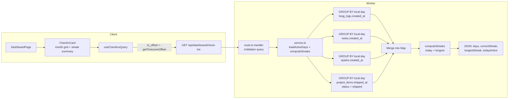

# Implementation Plan: Daily Active Check-In (Monthly Heatmap & Streaks)

**Status:** Proposed
**Feature surface:** Dashboard widget on `/dashboard` + `GET /api/dashboard/check-ins`
**Runtime:** Cloudflare Workers + D1 (all data derived, **no new table, no migration**)
**Frontend:** React 19 + React Query + Tailwind CSS v4 + date-fns

---

## 1. Executive Summary & Goals

### 1.1 Context
`pdevlog` records user activity in four places: brag logs, notes, sparks, and shipped
project items (backlog → changelog). Today the dashboard shows only totals and a recent
activity feed. There is no sense of *consistency* — whether the user showed up day after
day.

### 1.2 Core Objectives
1. **Monthly activity view:** a calendar of the current month where each day is a dot
   containing its date number, tinted by how many actions the user took that day (darker
   primary = more), with prev/next month navigation and a Less→More legend.
2. **Streaks:** current streak (consecutive active days, with a grace period of "today not
   over yet") and longest streak.
3. **Zero new writes:** a day is "active" when the user created a brag log / note / spark
   or shipped a project item that day. Everything is derived from existing rows, so no new
   table, no migration, and no manual "check in" button.
4. **Local-day correctness:** a day is bucketed in the user's timezone, not UTC.
5. **Zero impact on existing features:** one additive authenticated endpoint and one
   dashboard card; no changes to the other routes, schemas, or config.

### 1.3 Non-Goals (explicitly skipped)
- Manual check-in button / explicit check-in records.
- Notifications or reminders.
- Badges, rewards, or gamification beyond the two streak numbers.
- A dedicated `/check-ins` page, weekly/yearly views, export, or backfill.
- Counting edits (`updated_at`) as activity.

---

## 2. Definition: What Counts as an Active Day

A local calendar day is **active** if at least one of these events falls on it:

| Source | Table | Timestamp column | Filter |
| :--- | :--- | :--- | :--- |
| Brag log created | `brag_logs` | `created_at` | `user_id = ?` |
| Note created | `notes` | `created_at` | `user_id = ?` |
| Spark captured | `sparks` | `created_at` | `user_id = ?` (any status, including archived/promoted) |
| Backlog item shipped to changelog | `project_items` | `shipped_at` | `user_id = ?` AND `status = 'shipped'` AND `shipped_at IS NOT NULL` |

### 2.1 Rules and Rationale
- **Brag logs use `created_at`, not `occurred_at`.** The feature measures app activity
  (showing up to log), and `created_at` is the timestamp that always exists. Using
  `occurred_at` would let a single writing session mark arbitrary past days active.
- **Creation and ship events only; edits do not count.** Editing an old note should not
  retroactively light up today. This keeps the heatmap a truthful log of new output.
- **Unshipping removes the day.** `shipped_at` is not cleared when an item is moved back
  out of `shipped` (see `src/worker/features/projects/route.ts:509`), so the query filters
  on `status = 'shipped'`. This avoids "ghost" activity for items no longer in the
  changelog.
- **A promoted spark plus its resulting note count as two actions on that day.** Counts
  are per source; the heatmap color reflects total actions, tooltips break them down.
- **Timezone is a fixed offset supplied by the client** (`tz_offset`, minutes east of
  UTC). See §7 for the exact convention and the DST caveat.

---

## 3. Architecture



No migration runs. The four queries return one row per active day per source (not one row
per record), so the payload and memory cost scale with days since signup (~365/year), not
with record count.

---

## 4. API Contract

### 4.1 Endpoint
`GET /api/dashboard/check-ins?tz_offset=<minutes>`

- Authenticated: covered by the existing `authMiddleware` on `/api/*`; scoped to
  `c.get("userId")`. Cross-user data never appears (each query filters `user_id`).
- `tz_offset` (optional, integer, `-840..840`, default `0`): minutes **east** of UTC.
  The client sends `-new Date().getTimezoneOffset()` (UTC+7 → `420`).
- Invalid `tz_offset` → `400` from `zValidator`.
- Unauthenticated → `401`.

### 4.2 Response (200)

```json
{
  "days": [
    {
      "date": "2026-10-13",
      "total": 3,
      "bragLogs": 1,
      "notes": 1,
      "sparks": 1,
      "projectItems": 0
    },
    {
      "date": "2026-10-14",
      "total": 1,
      "bragLogs": 0,
      "notes": 0,
      "sparks": 0,
      "projectItems": 1
    }
  ],
  "currentStreak": 2,
  "longestStreak": 9,
  "todayActive": true
}
```

### 4.3 Field Semantics
- `days`: **only active days** for the entire history, ascending by date, each with a
  per-source breakdown and `total`. The client renders empty days locally, and month
  navigation needs no refetch. Date strings are `YYYY-MM-DD` in the user's offset.
- `currentStreak`: consecutive active days ending at the user's *today*. If today is not
  active yet but yesterday is, the streak is still alive (grace until local midnight).
  If neither today nor yesterday is active, it is `0`.
- `longestStreak`: longest run of consecutive active days across all history.
- `todayActive`: `days` contains the user's local today.

### 4.4 Shared Schema — `src/shared/schemas/check-in.ts` (new)

```ts
import { z } from "zod";

export const checkInDaySchema = z.object({
  date: z.string(),
  total: z.number().int(),
  bragLogs: z.number().int(),
  notes: z.number().int(),
  sparks: z.number().int(),
  projectItems: z.number().int(),
});

export const checkInsResponseSchema = z.object({
  days: z.array(checkInDaySchema),
  currentStreak: z.number().int(),
  longestStreak: z.number().int(),
  todayActive: z.boolean(),
});

export const checkInsQuerySchema = z.object({
  tz_offset: z.coerce.number().int().min(-840).max(840).default(0),
});

export type CheckInDay = z.infer<typeof checkInDaySchema>;
export type CheckInsResponse = z.infer<typeof checkInsResponseSchema>;
export type CheckInsQuery = z.infer<typeof checkInsQuerySchema>;
```

---

## 5. Worker Implementation

Order per `AGENTS.md`: shared schema → service → route, then client. No changes to
`wrangler.jsonc`, `worker-configuration.d.ts`, `vitest.config.ts`, or `tsconfig`.

### 5.1 `src/worker/features/dashboard/service.ts` (new)

Mirrors the `route.ts` + `service.ts` split used by the profile feature.

```ts
import { and, count, eq, isNotNull, sql } from "drizzle-orm";

import { bragLogs, notes, projectItems, sparks } from "@/worker/db/schema";
import type { Database } from "@/worker/db";

const MS_PER_DAY = 86_400_000;

function tzModifier(tzOffsetMinutes: number): string {
  const sign = tzOffsetMinutes >= 0 ? "+" : "-";
  return `${sign}${Math.abs(tzOffsetMinutes)} minutes`;
}

function dayKey(timestampMs: number, tzOffsetMinutes: number): string {
  return new Date(timestampMs + tzOffsetMinutes * 60_000)
    .toISOString()
    .slice(0, 10);
}

function epochDay(day: string): number {
  const [year, month, date] = day.split("-").map(Number);
  return Date.UTC(year!, month! - 1, date!) / MS_PER_DAY;
}

function previousDay(day: string): string {
  return new Date((epochDay(day) - 1) * MS_PER_DAY).toISOString().slice(0, 10);
}
```

`loadActiveDays(db, userId, tzOffsetMinutes)` runs four grouped queries in parallel:

```ts
const modifier = tzModifier(tzOffsetMinutes);
const groupedDay = (column: AnySQLiteColumn) =>
  sql<string>`date(${column} / 1000, 'unixepoch', ${modifier})`;

const [bragRows, noteRows, sparkRows, itemRows] = await Promise.all([
  db.select({ day: groupedDay(bragLogs.createdAt), value: count() })
    .from(bragLogs)
    .where(eq(bragLogs.userId, userId))
    .groupBy(groupedDay(bragLogs.createdAt)),
  // notes.created_at, sparks.created_at: identical shape
  db.select({ day: groupedDay(projectItems.shippedAt), value: count() })
    .from(projectItems)
    .where(and(
      eq(projectItems.userId, userId),
      eq(projectItems.status, "shipped"),
      isNotNull(projectItems.shippedAt),
    ))
    .groupBy(groupedDay(projectItems.shippedAt)),
]);
```

Then merge into a `Map<string, { bragLogs; notes; sparks; projectItems }>`, compute
`total` per day, sort ascending. `computeStreaks(days, todayKey)` is a pure exported
function:

```ts
export function computeStreaks(days: string[], todayKey: string) {
  const active = new Set(days.map(epochDay));
  const today = epochDay(todayKey);

  let longest = 0;
  let run = 0;
  for (const day of [...active].sort((a, b) => a - b)) {
    run = active.has(day - 1) ? run + 1 : 1;
    longest = Math.max(longest, run);
  }

  let current = 0;
  let cursor = active.has(today) ? today : today - 1;
  while (active.has(cursor)) {
    current += 1;
    cursor -= 1;
  }
  return { current, longest, todayActive: active.has(today) };
}
```

`todayKey` is `dayKey(Date.now(), tzOffsetMinutes)`.

### 5.2 `src/worker/features/dashboard/route.ts` (edit)

Add one handler; the dashboard route is already mounted in `src/worker/index.ts:35`, so no
mounting change:

```ts
import { zValidator } from "@hono/zod-validator";
import { checkInsQuerySchema } from "@/shared/schemas/check-in";
import { loadActiveDays, computeStreaks } from "./service";

type QueryInput<T> = { in: { query: T }; out: { query: T } };

const getCheckIns = async (
  c: Context<AppEnv, "/check-ins", QueryInput<CheckInsQuery>>,
) => {
  const userId = c.get("userId");
  const { tz_offset: tzOffset } = c.req.valid("query");
  const db = createDb(c.env.DB);

  const days = await loadActiveDays(db, userId, tzOffset);
  const todayKey = new Date(Date.now() + tzOffset * 60_000)
    .toISOString()
    .slice(0, 10);
  const summary = computeStreaks(days.map((day) => day.date), todayKey);

  return c.json({ days, ...summary } satisfies CheckInsResponse);
};

export const dashboardRoute = new Hono<AppEnv>()
  .get("/", getDashboard)
  .get("/recent", getRecentActivity)
  .get("/check-ins", zValidator("query", checkInsQuerySchema), getCheckIns);
```

Do **not** add rate limiting: the endpoint is read-only, cheap (4 grouped queries), and
consistent with `/api/dashboard` and `/api/dashboard/recent`.

### 5.3 Indexes — deliberately skipped
`notes` and `brag_logs` lack a `(user_id, created_at)` index. The grouped queries scan the
user's own rows, which is fine for this app's scale. If a user ever accumulates tens of
thousands of rows and the dashboard query shows up in observability, add a migration with
`(user_id, created_at)` indexes (sparks already has a usable `(user_id, status, created_at)`
prefix for its query). Not required now.

---

## 6. Client Implementation

### 6.1 `src/client/features/dashboard/api.ts` (edit)

Follow the existing `queryOptions` + hook pattern:

```ts
import { checkInsResponseSchema, type CheckInsResponse } from "@/shared/schemas/check-in";

const CHECK_INS_KEY = ["dashboard", "check-ins"] as const;

export async function fetchCheckIns(): Promise<CheckInsResponse> {
  const tzOffset = -new Date().getTimezoneOffset();
  const response = await client.api.dashboard["check-ins"].$get({
    query: { tz_offset: String(tzOffset) },
  });
  if (!response.ok) {
    throw await parseApiError(response, "Failed to load check-ins");
  }
  return checkInsResponseSchema.parse(await response.json());
}

export const checkInsQueryOptions = queryOptions({
  queryKey: CHECK_INS_KEY,
  queryFn: fetchCheckIns,
});

export function useCheckInsQuery() {
  return useQuery(checkInsQueryOptions);
}
```

The typed Hono client (`hc<AppType>`) picks up the new route automatically once the
handler is typed as above — no client-side type redeclaration. React Query refetches on
window focus/mount, so crossing local midnight self-corrects on the next visit.

### 6.2 `src/client/features/dashboard/check-in-card.tsx` (new)

A self-contained card; no route, no context, no URL state.

**State**
- `monthCursor: Date` — initially `startOfMonth(new Date())`.
- Prev/next `Button`s (`variant="ghost" size="icon-sm"`, `ChevronLeft/Right`,
  `aria-label="Previous month"` / `"Next month"`); next is `disabled` when the cursor is
  the current month (no future view).

**Derived data (useMemo)**
- `dayMap = new Map(days.map(d => [d.date, d]))`.
- Grid via date-fns (already a dependency, used by `date-picker.tsx`):
  `startOfWeek(startOfMonth(cursor))` → `endOfWeek(endOfMonth(cursor))` with
  `eachDayOfInterval`, chunked into weeks; day labels `Mon..Sun` via `format(day, "EEEEE")`.
- `activeThisMonth` count and `todayKey = format(new Date(), "yyyy-MM-dd")`.

**Cell rendering — rounded dots, theme tint (no emoji, no fixed green)**
- Each day is a circle containing its date number, centered in its grid cell:
  `mx-auto flex aspect-square w-full max-w-8 items-center justify-center rounded-full
  text-[11px] font-medium tabular-nums`.
- Intensity by `total`, using the theme's primary color (works light + dark):
  0 → `bg-muted/40 text-muted-foreground`, 1 → `bg-primary/20 text-foreground`,
  2 → `bg-primary/45 text-foreground`, 3 → `bg-primary/70 text-primary-foreground`,
  4+ → `bg-primary text-primary-foreground`.
- Outside-current-month days: `opacity-40`.
- Today: `ring-2 ring-primary ring-offset-2 ring-offset-background`; when today has no
  activity, use a dashed `border border-primary/40` instead, as a quiet nudge.
- Legend under the grid: `Less` + five sample dots (0–4+) + `More`, so the tint scale is
  self-explanatory, plus a small legend row mapping the summary icons to sources.
- `title` + `aria-label`: `"Oct 14, 2026 · 3 activities (1 note, 2 sparks)"` or
  `"Oct 14, 2026 · no activity"`. Container gets
  `aria-label={`Activity in ${format(monthCursor, "MMMM yyyy")}`}`.

**Summary row** (lucide icons, matching dashboard style)
- `Flame` Current streak: `N days`
- `Trophy` Best streak: `N days`
- `CalendarCheck` This month: `N / <daysInMonth> days`
- When `!todayActive`: an inline CTA `"Nothing logged today"` linking to `/sparks` (or the
  spark capture action via `useSparks()` — pick the simple link if the provider isn't
  available in the card's tree; it is inside `AppLayout`, so `useSparks()` also works).

**States**
- Loading: pulsing card skeleton sized like the grid (consistent with
  `DashboardSkeleton`).
- Error: compact inline error with a "Try again" `Button` calling `refetch()`, matching
  the dashboard error block.
- Empty (no `days` at all): grid still renders (all muted) plus
  "No activity yet — write a spark to start your streak."

### 6.3 `src/client/features/dashboard/dashboard-page.tsx` (edit)

Insert the card **full-width between the stat cards and the activity/snapshot grid**:

```tsx
<div className="grid gap-4 sm:grid-cols-2 lg:grid-cols-4">{stats.map(...)}</div>

<CheckInCard />

<div className="grid grid-cols-1 gap-6 lg:grid-cols-12">{/* existing */}</div>
```

The calendar is 7 columns, so it fits mobile without touching the bottom nav. No new nav
item, no router change, no sidebar change.

---

## 7. Timezone Handling

| Concern | Decision |
| :--- | :--- |
| Convention | `tz_offset` = minutes **east** of UTC. Client: `-new Date().getTimezoneOffset()` (UTC+7 → `420`). Validated to `-840..840`. |
| SQL bucketing | D1 SQLite `date(created_at / 1000, 'unixepoch', ?)` with a validated modifier string like `"+420 minutes"` (parameters are bound, never string-concatenated from raw input — the sign/abs are derived from a validated integer). |
| "Today" | `new Date(Date.now() + tzOffset * 60_000).toISOString().slice(0, 10)` — the same fixed-offset convention as SQL, so server streaks and client cells agree. |
| DST | A fixed offset captured at request time can misplace timestamps within ~1 hour of local midnight for months on the other side of a DST change. Accepted: worst case is one day is off-by-one at the edge of a month, for activity logged around midnight. If this ever matters, switch to sending an IANA zone and bucket with `Intl.DateTimeFormat` in JS. |
| Midnight rollover | React Query refetches on focus; the server also re-derives `todayActive`/streaks per request, so the card corrects itself on the next visit after midnight. No timers needed. |

---

## 8. Testing & QA Plan

Vitest runs inside the Workers runtime; migrations are applied by
`tests/setup/apply-migrations.ts`, and this feature adds no migration, so the existing
setup works unchanged.

### 8.1 `tests/isolation/check-ins.test.ts` (new)

Copy `createUser`/`request` from `tests/isolation/workspaces.test.ts`. Insert rows with
`env.DB.prepare(...)` and crafted timestamps relative to `Date.now()` (compute `todayKey`
once at the top of the test to avoid a midnight race; use `tz_offset=0` for determinism).

1. **Empty user:** `days: []`, `currentStreak: 0`, `longestStreak: 0`,
   `todayActive: false`.
2. **All four sources:** insert 1 brag log, 1 note, 1 spark (today), 1 shipped project
   item (today) and 1 `in_progress` item with a `shipped_at` (today, must be ignored).
   Expect one day with `total: 4`, correct per-source counts, `todayActive: true`.
3. **Streak math:** rows on today, today−1, today−2 and a gap at today−3, plus an old
   isolated run of 4 days. Expect `currentStreak: 3` and `longestStreak: 4`.
4. **Grace period:** only today−1 active → `currentStreak: 1`; only today−2 active →
   `currentStreak: 0`.
5. **Timezone bucketing:** a timestamp at `18:00Z` on a fixed date is bucketed to the next
   local day with `tz_offset=420` and to the same UTC day with `tz_offset=0`.
6. **Isolation:** user B's rows do not appear in user A's response (both users active
   today; A sees only its own).
7. **Validation/auth:** `tz_offset=9999` → `400`; no cookie → `401`.

### 8.2 `tests/unit/check-in-streaks.test.ts` (new, small)

Import `computeStreaks` from the service and cover the pure boundary cases directly:
empty set; single day today; run ending yesterday; run broken by a missing day; longest
run in the middle of history.

### 8.3 Verification commands
```bash
bun run typecheck
bun run lint
bunx vitest run tests/isolation/check-ins.test.ts tests/unit/check-in-streaks.test.ts
bun run test          # full suite before pushing
```

Manual check: `bun run dev`, open `/dashboard`, confirm the current month grid, navigate
one month back, verify tooltips/counts against the seeded activity, verify mobile width,
and confirm dark/light themes.

---

## 9. Risk Assessment & Mitigation

| Risk | Impact | Probability | Mitigation |
| :--- | :--- | :--- | :--- |
| DST edge misplaces a day by one | Minor visual inaccuracy twice a year | Low | Fixed-offset convention documented; switch to IANA zone if reported. |
| Four unindexed scans on large accounts | Slow dashboard | Low | Grouped queries return days not rows; optional `(user_id, created_at)` index migration if observability shows cost. |
| Payload grows with account age | Larger response | Very Low | ~365 entries/year of small objects; add `from`/`to` params only if needed. |
| Midnight/date race in tests | Flaky test | Low | Compute `todayKey` once at test start; use `tz_offset=0`; relative timestamps. |
| Client spoofs `tz_offset` | Wrong personal display | Very Low | It only affects the caller's own visible day bucketing; no security or data impact. |
| Users expect edited old entries to count | Confusion | Low | Card subtitle states the rule: "Brag logs, notes, sparks, and shipped items you create each day." |

---

## 10. Rollback Plan

1. Revert the commit (new schema file, service, route handler, client card, tests).
2. No database migration, no data written, no config change — nothing to undo server-side.
3. `GET /api/dashboard/check-ins` 404s after revert (falls through `notFound`), and the
   dashboard card is gone; the rest of the dashboard is untouched.

---

## 11. Implementation Checklist

1. `src/shared/schemas/check-in.ts` (new).
2. `src/worker/features/dashboard/service.ts` (new): `loadActiveDays`, `computeStreaks`.
3. `src/worker/features/dashboard/route.ts` (edit): handler + `zValidator` route.
4. `src/client/features/dashboard/api.ts` (edit): query options + hook.
5. `src/client/features/dashboard/check-in-card.tsx` (new).
6. `src/client/features/dashboard/dashboard-page.tsx` (edit): render card.
7. `tests/isolation/check-ins.test.ts`, `tests/unit/check-in-streaks.test.ts` (new).
8. Run `bun run typecheck && bun run lint && bun run test`.
