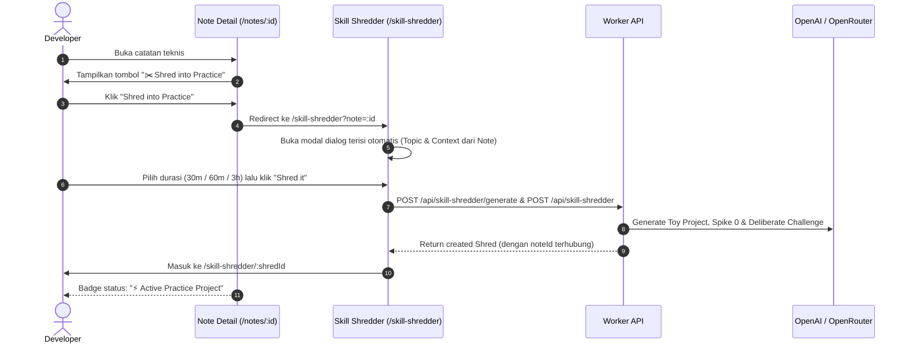
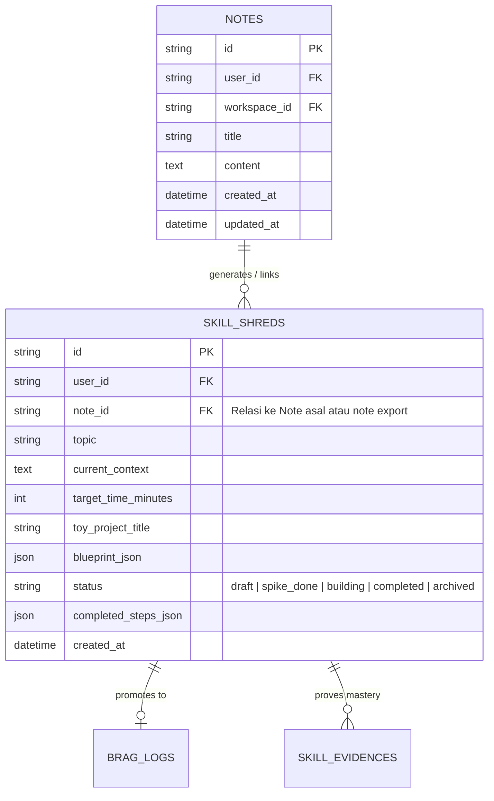

# Technical & Product Plan: Note to Skill Shredder (Opsi A)

> **Status:** Planned / Ready for Implementation  
> **Target Version:** `pdevlog` v0.4+  
> **Audience:** Solo Software Engineer / Autonomous Builder  
> **Core Objective:** Mengonversi catatan teknis (*Notes*) secara utuh menjadi proyek latihan tangan (*Toy Project*) melalui sistem **Skill Shredder**, mengubah catatan pasif (*collector's fallacy*) menjadi aksi terukur dengan *Spike 0*, milestone bertahap, dan tantangan tanpa AI.

---

## 1. Problem Statement & Nilai Produk

### 1.1 "Collector's Fallacy" pada Developer
Engineer sering menghabiskan waktu berjam-jam membaca dokumentasi baru, arsitektur sistem, atau artikel teknis mendalam lalu menyimpannya sebagai catatan rapi di `pdevlog` (misal: *"D1 Read Replication"*, *"Raft Consensus Basics"*, *"CSS Container Queries"*).

Namun, realitasnya:
1. **Catatan Berakhir Pasif:** Setelah dicatat, 80%+ catatan tidak pernah dipraktikkan atau dibaca ulang.
2. **Ilusi Penguasaan (*Illusion of Competence*):** Menyimpan ringkasan sintaks terasa seperti sudah menguasai ilmunya, padahal saat diminta coding dari nol tanpa AI/Google, developer masih bingung.
3. **Loop Belum Tertutup:** Saat ini `pdevlog` baru mendukung:
   * **Spark $\to$ Skill Shredder** (ide mentah di-*shred*).
   * **Skill Shredder $\to$ TIL Note** (*export blueprint* menjadi catatan baru).
   * **Belum ada alur Note $\to$ Skill Shredder** untuk menguji catatan riset yang sudah ada.

### 1.2 Mengapa Opsi A (Shred Whole Note)?
* **Frictionless (1-Click Action):** Tidak perlu ribet memilih teks atau memformat ulang. Cukup klik tombol *"✂️ Shred into Practice"* di halaman catatan.
* **Konteks Utuh untuk AI:** AI menerima judul catatan sebagai topik (`topic`) dan isi catatan sebagai konteks pemahaman (`currentContext`), sehingga *Toy Project* yang dihasilkan benar-benar membuktikan konsep spesifik yang ada di catatan tersebut.
* **Full Closed-Loop Ecosystem:**
  $$\text{Riset/Catatan (Note)} \longrightarrow \text{Tantangan Praktik (Skill Shredder)} \longrightarrow \text{Pencapaian Nyata (Brag Log)} \longrightarrow \text{Bukti Kompetensi (Skill Radar)}$$

---

## 2. Arsitektur Alur & Relasi Entitas

### 2.1 Alur Pengguna (User Flow)



### 2.2 Relasi Entitas (ER Diagram)

Di skema database D1 saat ini, tabel `skill_shreds` sudah memiliki kolom `note_id`. Kita memanfaatkan relasi ini untuk hubungan dua arah:



---

## 3. Spesifikasi UX & Antarmuka

### 3.1 Note Detail Page (`/notes/:id`)
1. **Header Action Bar:**
   * Di sebelah tombol *PDF Print*, *Edit*, dan *Delete*, tambahkan tombol baru:
     ```tsx
     <Button variant="outline" size="sm" asChild>
       <Link to={`/skill-shredder?note=${note.id}`}>
         <Scissors className="size-4" />
         Shred into Practice
       </Link>
     </Button>
     ```
2. **Linked Practice Banner (Jika Catatan Sudah Di-shred):**
   * Di bawah judul catatan atau di atas konten, tampilkan banner ringkas jika ada `skill_shred` yang aktif atau selesai terkait catatan ini:
     * **Saat status `building` / `spike_done`:**
       > ⚡ **Active Practice:** *2-client terminal walkie-talkie* (2/4 steps completed) — [Lanjutkan Latihan $\to$](/skill-shredder/:shredId)
     * **Saat status `completed`:**
       > ✅ **Practice Completed:** Toy project berhasil diselesaikan dan terverifikasi. — [Lihat Detail $\to$](/skill-shredder/:shredId)

### 3.2 Skill Shredder Page (`/skill-shredder`)
1. **Query Param Handler (`?note=<noteId>`):**
   * Mirip seperti `?spark=<sparkId>`, tangkap `searchParams.get("note")`.
   * Panggil `useNoteDetailQuery(noteId)` untuk memuat judul dan konten catatan.
2. **Pre-filled Dialog (`ShredInputDialog`):**
   * `Topic`: Diisi `note.title` (dipotong rapi maksimal 200 karakter).
   * `Current Context`: Diisi ringkasan/ekstrak dari `note.content` (membersihkan syntax markdown berlebih, maksimal 500 karakter).
   * `Target Time`: Pilihan radio/select default 60 menit.
   * `Source Note Badge`: Indikator visual kecil *"Membuat latihan dari: [Judul Note]"*.

### 3.3 Skill Shredder Detail Page (`/skill-shredder/:id`)
1. **Tautan Balik ke Note Asal:**
   * Jika `shred.noteId` ada dan catatan masih eksis, tampilkan info di bagian atas:
     > 📖 *Berdasarkan catatan:* [Judul Catatan](/notes/:noteId)
2. **Logika Ekspor saat Selesai:**
   * Tombol *"Export to TIL note"* yang sudah ada saat ini disesuaikan:
     * Jika shred berasal dari catatan yang sudah ada, berikan opsi:
       1. **Append TIL ke Catatan Asal:** Menambahkan section `## Hands-on Implementation (Toy Project)` di bagian bawah catatan asal.
       2. **Export sebagai Catatan Baru:** Membuat catatan TIL mandiri seperti behaviour saat ini.

---

## 4. Spesifikasi Teknis & API

### 4.1 Shared Schemas (`src/shared/schemas/skill-shredder.ts`)

Perbarui `createSkillShredSchema` untuk menerima `noteId` opsional saat pembuatan shred:

```typescript
export const createSkillShredSchema = z.object({
  topic: z.string().trim().min(1).max(200),
  currentContext: z.string().trim().max(500).optional(),
  targetTimeMinutes: z.number().int().min(15).max(240).default(60),
  blueprint: skillShredderResultSchema,
  noteId: z.string().optional(), // ID catatan sumber
});
```

Tambahkan query schema untuk mencari shred berdasarkan `note_id`:

```typescript
export const listSkillShredsQuerySchema = z.object({
  note_id: z.string().optional(),
});
```

### 4.2 Worker API Routes (`src/worker/features/skill-shredder/route.ts`)

1. **`POST /api/skill-shredder` (Create Shred):**
   * Baca `input.noteId`.
   * Jika `noteId` disertakan, verifikasi bahwa catatan tersebut dimiliki oleh `userId` yang sedang login:
     ```typescript
     if (input.noteId) {
       const [ownedNote] = await db
         .select({ id: notes.id })
         .from(notes)
         .where(and(eq(notes.id, input.noteId), eq(notes.userId, userId)))
         .limit(1);
       if (!ownedNote) {
         return c.json({ error: "Source note not found" }, 404);
       }
     }
     ```
   * Simpan `noteId` langsung saat insert ke tabel `skill_shreds`.

2. **`GET /api/skill-shredder` (List Shreds):**
   * Dukung filter opsional `?note_id=<id>`:
     ```typescript
     const noteId = c.req.query("note_id");
     const conditions = [eq(skillShreds.userId, userId)];
     if (noteId) {
       conditions.push(eq(skillShreds.noteId, noteId));
     }
     ```

### 4.3 AI Client Tuning (`src/worker/lib/ai-client.ts`)

Prompt `SKILL_SHREDDER_SYSTEM_PROMPT` saat ini sudah sangat solid untuk membuat Toy Project. Untuk mendukung input dari catatan, helper `buildSkillUserPrompt` disesuaikan agar lebih eksplisit jika konteks berasal dari riset/catatan teknis:

```typescript
function buildSkillUserPrompt(
  topic: string,
  currentContext: string | undefined,
  targetTimeMinutes: number,
): string {
  const context = currentContext
    ? `Reference material & what I understand from my notes:\n"""\n${currentContext}\n"""\n\n`
    : "";
  return `I have about ${targetTimeMinutes} minutes for deliberate practice today.\n\n${context}Topic to prove and implement hands-on: ${topic}`;
}
```

---

## 5. Rencana Tahapan Eksekusi (Implementation Milestones)

| Fase | Pekerjaan | Estimasi Kompleksitas |
| :--- | :--- | :---: |
| **Fase 1: Schema & API Contract** | • Update `createSkillShredSchema` dengan `noteId`<br>• Update `createShredHandler` untuk memvalidasi dan menyimpan `noteId`<br>• Tambahkan filter `note_id` pada query list shreds | Rendah |
| **Fase 2: Frontend Query & Dialog** | • Tambahkan `useNoteDetailQuery` di `SkillShredderPage` jika ada query param `?note=`<br>• Prefill topic dan markdown snippet di `ShredInputDialog`<br>• Simpan `noteId` saat memanggil `createMutation` | Sedang |
| **Fase 3: Note Detail Page UI** | • Tambahkan tombol aksi *"✂️ Shred into Practice"* di `NoteDetailPage`<br>• Tambahkan query status shred terkait catatan ini (`useSkillShredsQuery({ note_id: note.id })`)<br>• Tampilkan banner status aktif / selesai jika sudah pernah di-shred | Sedang |
| **Fase 4: Detail Shred & Bi-directional Links** | • Tampilkan link balik ke catatan asal di `SkillShredderDetailPage`<br>• Rapikan flow export (opsi update catatan asal vs catatan baru) | Rendah |
| **Fase 5: Testing & Verification** | • Unit test AI prompt dengan konteks catatan<br>• Isolation tests untuk flow `Note -> Shred` dengan validasi data isolation antar-user<br>• Manual testing interaksi UI di browser | Sedang |

---

## 6. Testing & Kriteria Keberhasilan (Acceptance Criteria)

- [ ] **Validasi Kepemilikan (Data Isolation):** User A tidak bisa mengaitkan `noteId` milik User B ke shred miliknya (mengembalikan status HTTP 404).
- [ ] **1-Click Launch dari Note:** Mengklik tombol *"Shred into Practice"* di halaman catatan langsung membuka dialog dengan judul dan isi catatan terisi rapi.
- [ ] **Panjang Karakter Aman:** Jika catatan sangat panjang (misal 5.000 kata), context dipotong aman (maksimal 500 karakter / cuplikan representatif) tanpa merusak payload JSON ke AI.
- [ ] **Indikator Status Dua Arah:** Note yang sudah di-shred menampilkan banner latihan aktif, dan halaman Shred menampilkan link balik ke catatan sumber.
- [ ] **Integrasi Skill Radar:** Shred yang selesai dari catatan tetap dapat di-attach sebagai *Evidence* di sistem *Engineering Competency & Skill Radar*.

