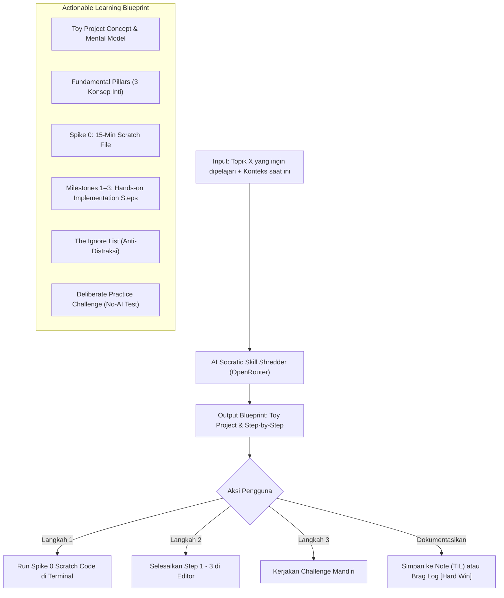

# Technical & Product Plan: Skill Shredder (Fundamental Toy-Project Deconstructor)

> **Status:** Planned / Evolved from PRD Shredder  
> **Target Audience:** Solo Software Engineer / Self-Directed Learner  
> **Core Objective:** Mengeliminasi *tutorial hell* dan *overthinking* saat ingin belajar teknologi/konsep baru dengan mendekonstruksinya menjadi **Toy Project Minimalis** (seperti analogi Todo App pada fullstack) yang berfokus 100% pada pemahaman fundamental, bebas distraksi, dan langsung dieksekusi secara hands-on.

---

## 1. Latar Belakang: Mengapa Belajar Hal Baru Sering Gagal?

### 1.1 Jebakan Umum Saat Ingin Belajar Topik X
Ketika seorang developer ingin menguasai topik baru (misal: *WebSockets, Redis Caching, Rust, Event-Driven Queue, Docker, Drizzle ORM*):
1. **Tutorial Hell (Pasif):** Menonton tutorial video 10 jam atau membaca dokumentasi berhari-hari tanpa pernah mengetik kode dari nol. Ilusi pemahaman (*illusion of competence*), tapi blank saat buka editor kosong.
2. **Over-Ambition (Bikin Sistem Terlalu Besar):** Langsung mencoba membuat SaaS / sistem besar lengkap dengan auth, database rumit, UI Tailwind cantik, dan deployment. Akhirnya lelah di urusan boilerplate sebelum sempat menyentuh topik inti yang ingin dipelajari.
3. **Bingung Mau Bikin Apa:** Tidak tahu proyek apa yang cukup kecil untuk diselesaikan dalam 1–2 jam, tapi cukup komprehensif untuk merangkum seluruh esensi fundamentalnya.

### 1.2 Solusi: The "Todo App" Effect (Toy-Project Deconstructor)
Dalam dunia fullstack web development, tutorial klasik selalu menggunakan **Todo App** bukan karena aplikasinya keren, melainkan karena Todo App adalah **alat belajar paling efisien**:
- Memaksa belajar operasi CRUD (Create, Read, Update, Delete).
- Memaksa belajar State Management & event handling.
- Memaksa belajar Form Validation & UI rendering.
- **Nol distraksi domain:** Tidak butuh mikir logika bisnis yang ribet.

**Skill Shredder** mengotomatiskan formulasi "Todo App" untuk *topik teknologi apa pun*:
Mengambil topik abstrak X $\rightarrow$ Merumuskan 1 Toy Project minimalis $\rightarrow$ Memberikan Spike 0 (15 menit) $\rightarrow$ Memecah menjadi 3 Milestone vertikal $\rightarrow$ Memasang Ignore List ketat $\rightarrow$ Memberikan Deliberate Practice Challenge (uji mandiri tanpa AI).

---

## 2. Struktur Blueprint: 6 Komponen Skill Shredder

```
┌────────────────────────────────────────────────────────────────────────┐
│                      STRUKTUR BLUEPRINT SKILL SHREDDER                 │
├────────────────────────────────────────────────────────────────────────┤
│ 🎯 THE "TOY PROJECT" FORMULATION (Analogi Todo App untuk Topik X)      │
│ • Nama & konsep proyek mainan minimalis yang self-contained.           │
│ • "Mengapa proyek ini mengajarkan 100% fundamental X tanpa distraksi." │
├────────────────────────────────────────────────────────────────────────┤
│ 🏛️ THE FUNDAMENTAL PILLARS (3-4 Fondasi Kunci)                         │
│ • Konsep arsitektur/logika inti yang WAJIB dipahami (bukan sekadar sintaks).│
├────────────────────────────────────────────────────────────────────────┤
│ 🧪 SPIKE 0: FIRST CONTACT SCRATCH (15–30 MENIT)                        │
│ • 1 file kotor / terminal snippet untuk membuktikan library/sintaks hidup.│
│ • Kriteria sukses: Console print / handshake berhasil. Rasa takut hilang.│
├────────────────────────────────────────────────────────────────────────┤
│ ⚡ MILESTONES 1–3: THE HANDS-ON BUILD (STEP-BY-STEP VERTICAL)           │
│ • Step 1: Scaffold minimalis & koneksi dasar.                          │
│ • Step 2: Aliran data inti (Core Interaction Loop).                   │
│ • Step 3: State / Error handling dasar.                                │
├────────────────────────────────────────────────────────────────────────┤
│ 🚫 THE IGNORE LIST (ANTI-RABBIT HOLE - DILARANG DIPIKIRKAN HARI INI)   │
│ • Hal-hal yang DILARANG dikerjakan agar tidak over-engineering:        │
│   (Contoh: Jangan bikin UI cantik, jangan pasang Auth, jangan mikir scale).│
├────────────────────────────────────────────────────────────────────────┤
│ 🧠 DELIBERATE PRACTICE CHALLENGE (UJI PEMAHAMAN TANPA AI)              │
│ • 1 tantangan modifikasi kecil yang harus kamu selesaikan sendiri      │
│   untuk membuktikan kamu benar-benar paham cara kerjanya.              │
└────────────────────────────────────────────────────────────────────────┘
```

---

## 3. Contoh Konkret Kasus Penggunaan

| Yang Ingin Dipelajari Pengguna | Proyek Besar yang Bikin Macet (Hindari) | Toy Project Rekomendasi Shredder | Spike 0 (15 Menit) | Ignore List (Dilarang) |
| :--- | :--- | :--- | :--- | :--- |
| **WebSockets** | Bikin clone Slack / Discord lengkap dengan channel & avatar | **Live Ticker / Anonymous 2-User Walkie-Talkie** | Script 1 file Hono WebSocket + `wscat` terminal | Dilarang bikin DB, room history, auth, styling UI |
| **Redis & Caching** | Caching platform e-commerce multi-region | **Cache Proxy Fetch API Publik** (bandingkan respons 1 vs respons 2) | Script node/bun yang SET & GET key sederhana | Dilarang mikir Redis Cluster, eviction policy rumit, pagination |
| **Message Queue / Event-Driven** | Microservices distributed order processing | **CLI Job Queue Simulator** (1 Producer kirim job, 1 Consumer proses job) | 1 script in-memory queue dengan `setTimeout` delay | Dilarang setup Kafka/RabbitMQ Docker, retry backoff kompleks |
| **Go Concurrency & Goroutines** | Distributed crawler scraping jutaan halaman web | **Parallel Ping Checker** (ping 5 URL bersamaan via Channels) | 1 fungsi goroutine dengan `sync.WaitGroup` | Dilarang bikin Web UI, storage database, rate limiter kompleks |

---

## 4. User Flow & Interaksi UX



### 4.1 Detail Tampilan Antarmuka (UI)
1. **Input Modal / Page:**
   - Input: *"Apa yang ingin kamu pelajari?"* (misal: "WebSockets di Cloudflare Workers", "Drizzle ORM relations").
   - Input opsional: *"Apa yang sudah kamu pahami saat ini?"* (misal: "Biasa pakai REST API fetch biasa").
   - Waktu yang tersedia: Pilihan chips `[30 Menit (Spike Saja)]`, `[1-2 Jam (Toy Project Lengkap)]`, `[Setengah Hari]`.
2. **Toy Project Hero Card:**
   - Judul & tagline analogi (contoh: *"Proyek: 2-Client Terminal Walkie-Talkie (Todo App-nya WebSockets)"*).
   - Penjelasan *"Mengapa proyek ini mengajarkan fundamental tanpa distraksi"*.
3. **Fundamental Pillars (Accordion / Grid):**
   - 3 kartu ringkas yang menjelaskan konsep kunci (misal: Handshake, Duplex Connection, Event Handling).
4. **Spike 0 Card (Interactive Scratch Runner):**
   - Kode scratch minimalis (10–15 baris).
   - Tombol *"Copy Scratch Code"*.
   - Countdown timer 15–20 menit.
   - Checklist: `[ ] Terminal jalan & terverifikasi`.
5. **Interactive Milestones (Steps 1–3):**
   - Checklist progresif dengan panduan "Apa yang diketik" dan "Cara verifikasi".
6. **Ignore List Card:**
   - Banner oranye tegas: *"Dilarang Dikerjakan Hari Ini (Agar Fokus Paham Fundamental)"*.
7. **Deliberate Practice Card (Tantangan Mandiri):**
   - Kotak refleksi: *"Tantangan: Ubah script agar menangani client disconnect tanpa error. Coba selesaikan tanpa bertanya ke AI!"*.
8. **Action Footer:**
   - *"Simpan sebagai Note / TIL"* $\rightarrow$ Menghasilkan dokumen TIL dengan struktur rapi.
   - *"Catat sebagai Brag Log"* $\rightarrow$ Menandai penguasaan skill dengan tag `[Hard Win - Pure Logic]`.

---

## 5. Desain Arsitektur & Skema Teknis

### 5.1 Shared Schemas (`src/shared/schemas/skill-shredder.ts`)

```typescript
import { z } from "zod";

export const skillShredderInputSchema = z.object({
  topic: z
    .string()
    .trim()
    .min(3, "Masukkan topik atau teknologi yang ingin kamu pelajari")
    .max(200, "Topik maksimal 200 karakter"),
  currentContext: z
    .string()
    .trim()
    .max(500, "Konteks latar belakang maksimal 500 karakter")
    .optional(),
  targetTimeMinutes: z.number().int().min(15).max(240).default(60),
});

export type SkillShredderInput = z.infer<typeof skillShredderInputSchema>;

// Fundamental Pillar
export const fundamentalPillarSchema = z.object({
  name: z.string().describe("Nama konsep fundamental inti, misal: 'Connection Handshake'"),
  explanation: z.string().describe("Penjelasan sederhana 1-2 kalimat mengapa konsep ini adalah jantung dari topik ini."),
});

// Spike 0: Scratch Experiment
export const spike0Schema = z.object({
  title: z.string().describe("Judul eksperimen 15 menit"),
  objective: z.string().describe("Tujuan spesifik membuktikan sintaks/koneksi hidup."),
  scratchSnippet: z.string().describe("Kode scratch minimalis 10-20 baris untuk dijalankan langsung di terminal/scratch file."),
  successCriteria: z.string().describe("Kriteria sukses terlihat di console/output."),
  estimatedMinutes: z.number().int().default(15),
});

// Implementation Milestone Step
export const milestoneStepSchema = z.object({
  stepNumber: z.number().int(),
  title: z.string().describe("Judul langkah implementasi"),
  actionDescription: z.string().describe("Apa yang harus dibuat atau diketik"),
  verificationGuide: z.string().describe("Cara memverifikasi langkah ini berhasil"),
  estimatedMinutes: z.number().int(),
});

// Deliberate Practice Challenge
export const practiceChallengeSchema = z.object({
  challenge: z.string().describe("Tantangan modifikasi logika tanpa bantuan AI untuk menguji pemahaman sejati."),
  hint: z.string().describe("Petunjuk konseptual tanpa membocorkan kode."),
});

// Full Output Schema
export const skillShredderResultSchema = z.object({
  topicTitle: z.string().describe("Judul topik belajar yang diformulasikan rapi"),
  toyProjectTitle: z.string().describe("Nama toy project minimalis (analog Todo App)"),
  toyProjectPitch: z.string().describe("Mengapa proyek ini mengajarkan 100% fundamental topik ini tanpa distraksi."),
  fundamentalPillars: z.array(fundamentalPillarSchema).min(2).max(4),
  spike0: spike0Schema,
  milestones: z.array(milestoneStepSchema).min(2).max(4),
  ignoreList: z.array(z.string()).min(3).max(5).describe("Hal-hal yang DILARANG dibuat/dipikirkan hari ini."),
  practiceChallenge: practiceChallengeSchema,
});

export type SkillShredderResult = z.infer<typeof skillShredderResultSchema>;
```

---

### 5.2 Database Schema (`src/worker/db/schema.ts`)

```typescript
export const skillShredStatus = ["draft", "spike_done", "building", "completed", "archived"] as const;
export type SkillShredStatus = (typeof skillShredStatus)[number];

export const skillShreds = sqliteTable(
  "skill_shreds",
  {
    id: text("id").primaryKey(),
    userId: text("user_id")
      .notNull()
      .references(() => users.id, { onDelete: "cascade" }),
    topic: text("topic").notNull(),
    currentContext: text("current_context"),
    targetTimeMinutes: integer("target_time_minutes").notNull().default(60),
    toyProjectTitle: text("toy_project_title").notNull(),
    blueprintJson: text("blueprint_json").notNull(), // Menyimpan SkillShredderResult lengkap
    status: text("status", { enum: skillShredStatus }).notNull().default("draft"),
    spikeCompletedAt: integer("spike_completed_at", { mode: "timestamp_ms" }),
    completedStepsJson: text("completed_steps_json").notNull().default("[]"), // Array of completed step indices
    challengeCompletedAt: integer("challenge_completed_at", { mode: "timestamp_ms" }),
    noteId: text("note_id").references(() => notes.id, { onDelete: "set null" }),
    createdAt: integer("created_at", { mode: "timestamp_ms" })
      .notNull()
      .default(sql`(unixepoch() * 1000)`),
    updatedAt: integer("updated_at", { mode: "timestamp_ms" })
      .notNull()
      .default(sql`(unixepoch() * 1000)`),
  },
  (table) => [
    index("skill_shreds_user_id_created_at_idx").on(table.userId, table.createdAt),
    index("skill_shreds_status_idx").on(table.userId, table.status),
  ]
);
```

---

### 5.3 AI Prompt Engineering (`src/worker/lib/ai-client.ts`)

Persona **Principal Staff Engineer & Pragmatic Educator**:

```typescript
const SKILL_SHREDDER_SYSTEM_PROMPT = `
You are a Principal Software Engineer and Pragmatic Mentor specializing in deliberate practice and rapid skill acquisition.
A developer wants to learn a specific topic or technology, but feels overwhelmed or stuck in "tutorial hell" not knowing what step-by-step project to build.

Your mission is NOT to generate a massive enterprise project or write generic theory documentation.
Your mission is to invent a hyper-focused "TOY PROJECT" (the "Todo App" equivalent of this topic):
A tiny, self-contained project with ZERO domain complexity that forces the developer to hands-on implement 100% of the topic's core fundamentals.

Instructions:
1. TOY PROJECT FORMULATION:
   - Invent a tiny project (e.g., for WebSockets: a 2-client live ticker; for Redis: a latency comparison cache proxy; for Go channels: a parallel ping worker).
   - Explain why this is the perfect "Todo App" equivalent that captures the core fundamentals without distractions.
2. FUNDAMENTAL PILLARS:
   - Identify 2-4 foundational pillars that form the bedrock of this topic (e.g., Connection Lifecycle, Duplex Messaging, State Synchronization).
3. SPIKE 0 (The 15-Minute Scratch Spike):
   - A 10-20 line throwaway scratch script or CLI command that proves the technology is alive.
   - Success criteria must be immediately verifiable in the console/terminal.
4. MILESTONES (2 to 4 vertical steps):
   - Logical incremental steps to build the Toy Project from scratch.
   - Each step must have a concrete action and verification method.
5. THE IGNORE LIST:
   - List 3-5 things they are STRICTLY FORBIDDEN from caring about today (e.g., "Do not build Auth", "Do not write CSS/styling", "Do not think about Docker/K8s/production scale", "Do not build a database if in-memory works").
6. DELIBERATE PRACTICE CHALLENGE:
   - 1 modification challenge that tests true understanding of the fundamental mechanics, intended to be solved WITHOUT AI assistance.

Tone: Encouraging, razor-sharp, practical, and strictly anti-overengineering.
`;
```

---

## 6. Integrasi dengan Ekosistem pdevlog

Fitur ini secara alami memperkuat modul-modul lain di `pdevlog`:
1. **Notes (TIL / Engineering Notes):** 1-klik untuk mengekspor hasil belajar, kode scratch, dan refleksi pemahaman menjadi Note berformat markdown rapi.
2. **Brag Log (STAR Hard Wins):** Saat Deliberate Practice Challenge selesai, user dapat mencatatnya sebagai pencapaian skill dengan tag `[Hard Win - Pure Logic]`.
3. **Sparks (Idea Bank):** Ide-ide eksplorasi teknologi dari Sparks dapat langsung di-shred menjadi rencana belajar praktis.

---

## 7. Tahapan Implementasi (Milestones)

- [ ] **Milestone 1 (Schema & AI Prompt Generator)**:
  - File schema `src/shared/schemas/skill-shredder.ts`.
  - Fungsi AI generator di `src/worker/lib/ai-client.ts` dengan schema output terstruktur.
  - Unit test generator di `tests/unit/skill-shredder.test.ts`.
- [ ] **Milestone 2 (Database & API Worker)**:
  - Skema tabel `skill_shreds` di `src/worker/db/schema.ts` & D1 migration.
  - Endpoint `/api/skill-shredder` (generate, list, get by id, patch progress, save to note).
  - Isolation test di `tests/isolation/skill-shredder.test.ts`.
- [ ] **Milestone 3 (Client UI & Interactive Learning View)**:
  - Modal input topik & waktu belajar.
  - Toy Project Hero Card & Fundamental Pillars display.
  - Interactive Spike 0 Card (Scratch snippet + Copy + Timer).
  - Progressive checklist Milestones & Ignore List Banner.
  - Deliberate Practice Challenge card.
- [ ] **Milestone 4 (Integrasi & Polish)**:
  - Tombol "Export to Note (TIL)" dan "Log as Brag Win".
  - Navigasi link di sidebar dashboard.
  - Verifikasi: `bun run typecheck`, `bun run lint`, `bun run test`.
