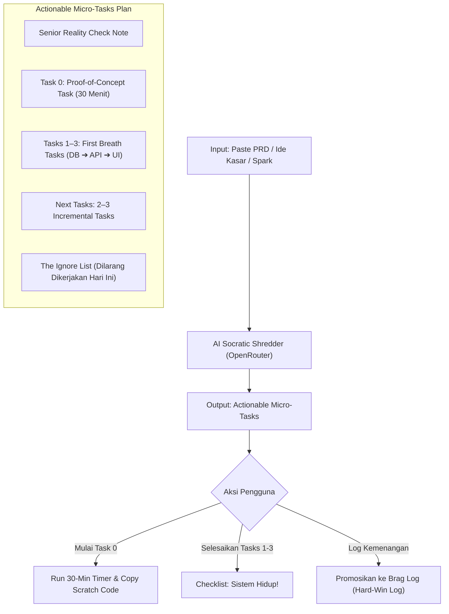

# Technical & Product Plan: PRD Shredder (Actionable Micro-Tasks)

> **Status:** Draft / Planned  
> **Target Audience:** Solo Software Engineer (In-House / Government / Flat Organization)  
> **Core Objective:** Mengeliminasi *analysis paralysis*, ketakutan terhadap proyek sulit, dan sindrom *PRD overwhelm* dengan memecah ide kompleks menjadi **Micro-Tasks Vertikal** yang ramah mental dan langsung menghasilkan produk hidup.

---

## 1. Mengapa "Micro-Tasks Vertikal" Bukan "To-Do List Biasa"?

### 1.1 Masalah Traditional Task Breakdown (Penyebab Overwhelm Masa Lalu)
Ketika PRD dipecah menjadi to-do list biasa (misalnya 20 task horisontal):
1. **Pola Horisontal:** Task 1–5 biasanya urusan setup DB, auth, dan boilerplate. Kamu koding seharian tanpa pernah melihat tombol yang bisa diklik di browser. Kelelahan datang sebelum ada hasil nyata (*delayed dopamine*).
2. **Task Bloat (Kelelahan Mental):** Melihat daftar 20–25 checklist membuat otak solo developer kewalahan: *"Banyak banget, kapan selesainya?"* $\rightarrow$ akhirnya ditinggalkan (*abandoned*).
3. **Memperlakukan Semua Task Sama:** Task mudah ("bikin tabel") dicampur dengan hal yang bikin takut ("integrasi library baru"), tanpa ada strategi menghilangkan rasa takut terlebih dahulu.

### 1.2 Solusi: 3-Layer Actionable Micro-Tasks
PRD Shredder membatasi jumlah task secara ketat dan memotong arsitektur secara **vertikal (tembus dari DB ke UI)**:

```
┌────────────────────────────────────────────────────────────────────────┐
│                      STRUKTUR MICRO-TASKS SHREDDER                     │
├────────────────────────────────────────────────────────────────────────┤
│ 🧪 TASK 0: THE PROOF-OF-CONCEPT TASK (30 MENIT)                        │
│ • Menyerang bagian yang paling bikin takut duluan di 1 file kotor.      │
│ • Kriteria sukses: console.log jalan, rasa takut hilang.              │
├────────────────────────────────────────────────────────────────────────┤
│ ⚡ TASKS 1–3: FIRST BREATH TASKS (WALKING SKELETON - 45 MENIT)          │
│ • Task 1 (DB)  : 1 tabel D1 paling minimal.                           │
│ • Task 2 (API) : 1 endpoint Hono yang membaca data itu.                │
│ • Task 3 (UI)  : 1 tombol/tampilan di React yang nampilin data itu.   │
│ 👉 SISTEM SUDAH HIDUP DARI HULU KE HILIR! (Immediate Dopamine)        │
├────────────────────────────────────────────────────────────────────────┤
│ 🚀 NEXT TASKS (MAKSIMAL 3–4 TASKS BERIKUTNYA)                          │
│ • Task 4: Form input nyata.                                           │
│ • Task 5: Validasi error & edge case.                                 │
├────────────────────────────────────────────────────────────────────────┤
│ 🚫 THE IGNORE LIST (DILARANG DIKERJAKAN HARI INI)                      │
│ • Hal-hal yang sengaja DIBUANG agar kamu tidak over-engineering.       │
└────────────────────────────────────────────────────────────────────────┘
```

---

## 2. Prinsip Desain Inti (The 4 Anti-Overwhelm Rules)

1. **Rule 1: Reality Check First (De-escalation)**
   Sebelum menampilkan task apa pun, sistem memberikan analisis santai dari Senior Staff Engineer:
   > *"Proyek ini kelihatannya seram karena ada buzzwords seperti 'Real-time WebSocket & Analytics'. Tapi intinya cuma: simpan event ke SQLite dan fetch via API. Jangan sentuh WebSocket dulu. Kamu pasti bisa."*
2. **Rule 2: Kill Fear with Task 0 (Throwaway POC)**
   Task pertama bukanlah membuat arsitektur bersih. Task pertama adalah membuktikan hal paling asing/menakutkan di 1 file scratch dalam waktu <30 menit. Kriteria suksesnya adalah output terminal sederhana.
3. **Rule 3: First Breath First (Tasks 1–3)**
   Tidak boleh ada task horisontal seperti *"buat 5 tabel database sekaligus"*. Task 1–3 harus berupa 1 jalur vertikal: 1 tabel $\rightarrow$ 1 API $\rightarrow$ 1 UI. Begitu data mengalir ke browser, rasa takut lenyap.
4. **Rule 4: The Ignore List (Guillotine)**
   AI secara tegas mencantumkan 3–5 hal yang **dilarang dijadikan task hari ini** (misal: dilarang bikin auth kompleks, dilarang merapikan styling CSS berlebihan, dilarang bikin settings page).

---

## 3. User Flow & Interaksi UX



### 3.1 Detail Tampilan Antarmuka (UI)
1. **Input Stage:** Textarea luas untuk paste PRD mentah, dengan pilihan target waktu pengerjaan hari ini (default: 45–60 menit).
2. **Reality Check Banner:** Callout box berwarna ramah (emerald/blue) yang meruntuhkan ilusi kompleksitas proyek.
3. **Task 0 Card (Proof of Concept):**
   - Checkbox besar: `[ ] Task 0: Buktikan [Konsep Kunci]`
   - Box kode scratch (10–15 baris) + tombol 1-klik *"Copy to Scratch File"*.
   - Countdown timer 30 menit.
   - Begitu dicentang: Animasi mikro dopamin $\rightarrow$ membuka Tasks 1–3.
4. **First Breath Card (Tasks 1–3):**
   - `[ ] Task 1 (Database)`: Buat skema D1 minimal.
   - `[ ] Task 2 (API)`: Buat endpoint Hono sederhana.
   - `[ ] Task 3 (UI)`: Tampilkan di komponen React.
   - Status badge: *"Walking Skeleton Live! Sistem Sudah Bernafas."*
5. **Ignore List Accordion:**
   - Banner oranye: *"Dilarang Dikerjakan Hari Ini (Agar Tidak Overwhelm)"*.
6. **Tombol "Log as Win (STAR)":**
   - Membuka form Brag Log otomatis dengan tag `[Hard Win - Pure Logic]` untuk merekam keberhasilan mengatasi proyek sulit.

---

## 4. Desain Arsitektur & Skema Teknis

### 4.1 Shared Schemas (`src/shared/schemas/prd-shredder.ts`)

```typescript
import { z } from "zod";

export const prdShredderInputSchema = z.object({
  title: z.string().trim().min(1, "Judul ide dibutuhkan").max(200).optional(),
  content: z
    .string()
    .trim()
    .min(30, "Masukkan setidaknya 30 karakter PRD/ide untuk dibedah")
    .max(15000, "PRD maksimal 15.000 karakter"),
  targetTimeMinutes: z.number().int().min(15).max(180).default(45),
  sourceSparkId: z.string().optional(),
});

export type PrdShredderInput = z.infer<typeof prdShredderInputSchema>;

// Task 0: Proof of Concept
export const pocTaskSchema = z.object({
  title: z.string().describe("Judul task 0, misal: 'Buktikan parsing XML di Worker'"),
  objective: z.string().describe("Tujuan spesifik yang ingin dibuktikan dalam 30 menit."),
  whyItMatters: z.string().describe("Mengapa task ini meruntuhkan ketakutan teknis terbesarmu."),
  scratchSnippet: z.string().describe("Contoh kode scratch minimalis (10-20 baris) untuk dijalankan di terminal."),
  successCriteria: z.string().describe("Kriteria sukses sederhana, misal: 'Console print status 200'."),
});

// Tasks 1-3: First Breath (Walking Skeleton)
export const firstBreathTasksSchema = z.object({
  dbTask: z.string().describe("Task 1: Perubahan skema database D1 paling minimal (1 tabel / 1 kolom)."),
  apiTask: z.string().describe("Task 2: 1 endpoint worker Hono paling sederhana untuk membaca/menulis data."),
  uiTask: z.string().describe("Task 3: 1 komponen UI React sederhana untuk menampilkan data tersebut."),
  verificationStep: z.string().describe("Cara memverifikasi data mengalir sukses dari DB ke UI."),
});

// Next Incremental Tasks
export const nextTaskItemSchema = z.object({
  taskNumber: z.number().int(),
  title: z.string().describe("Judul task yang ringkas dan actionable."),
  description: z.string().describe("Deskripsi langkah pengerjaan spesifik."),
  estimatedMinutes: z.number().int().describe("Estimasi waktu pengerjaan dalam menit (30-60 menit)."),
});

// Hasil Lengkap Shredder
export const prdShredderResultSchema = z.object({
  projectTitle: z.string().describe("Judul proyek yang ringkas dan membumi."),
  realityCheck: z
    .string()
    .describe("Pesan de-eskalasi dari Senior Staff Engineer yang menenangkan dan meruntuhkan ilusi bahwa proyek ini rumit."),
  pocTask: pocTaskSchema,
  firstBreathTasks: firstBreathTasksSchema,
  nextTasks: z.array(nextTaskItemSchema).max(4),
  ignoreList: z
    .array(z.string())
    .describe("3-5 hal yang DILARANG dijadikan task hari ini untuk mencegah over-engineering."),
});

export type PrdShredderResult = z.infer<typeof prdShredderResultSchema>;
```

---

### 4.2 Database Schema (`src/worker/db/schema.ts`)

Tabel untuk menyimpan riwayat shredding dan progress checklist task:

```typescript
export const ideaTaskStatus = ["shredded", "poc_done", "first_breath_done", "completed", "abandoned"] as const;
export type IdeaTaskStatus = (typeof ideaTaskStatus)[number];

export const shreddedIdeas = sqliteTable(
  "shredded_ideas",
  {
    id: text("id").primaryKey(),
    userId: text("user_id")
      .notNull()
      .references(() => users.id, { onDelete: "cascade" }),
    sparkId: text("spark_id").references(() => sparks.id, { onDelete: "set null" }),
    title: text("title").notNull(),
    rawContent: text("raw_content").notNull(),
    realityCheck: text("reality_check").notNull(),
    blueprintJson: text("blueprint_json").notNull(),
    status: text("status", { enum: ideaTaskStatus }).notNull().default("shredded"),
    pocCompletedAt: integer("poc_completed_at", { mode: "timestamp_ms" }),
    firstBreathCompletedAt: integer("first_breath_completed_at", { mode: "timestamp_ms" }),
    completedTasksJson: text("completed_tasks_json").notNull().default("[]"), // Array of completed task IDs/keys
    createdAt: integer("created_at", { mode: "timestamp_ms" })
      .notNull()
      .default(sql`(unixepoch() * 1000)`),
    updatedAt: integer("updated_at", { mode: "timestamp_ms" })
      .notNull()
      .default(sql`(unixepoch() * 1000)`),
  },
  (table) => [
    index("shredded_ideas_user_id_created_at_idx").on(table.userId, table.createdAt),
    index("shredded_ideas_status_idx").on(table.userId, table.status),
  ]
);
```

---

### 4.3 AI Prompt Engineering (`src/worker/lib/ai-client.ts`)

Prompt dengan persona **Senior Staff Engineer yang Anti-Overengineering**:

```typescript
const PRD_SHREDDER_SYSTEM_PROMPT = `
You are an empathetic Senior Staff Software Engineer mentoring a solo software engineer.
The developer is experiencing analysis paralysis, fear of difficult projects, and overwhelm from a complex PRD.

Your job is NOT to write a traditional 25-item project backlog.
Your job is to AGGRESSIVELY DEMYSTIFY the project and provide ACTIONABLE MICRO-TASKS:

1. REALITY CHECK:
   - Strip away enterprise buzzwords.
   - Explain what this project ACTUALLY is in 2 sentences of simple, reassuring language to destroy their fear.
2. TASK 0 (The Proof-of-Concept Task - 30 Minutes):
   - Identify the single hardest/scariest technical unknown causing fear (e.g., API integration, regex, streaming, auth).
   - Provide a 10-20 line throwaway scratch code snippet.
   - Success criterion must be dead simple: "Console prints status 200 or returns parsed object".
3. FIRST BREATH TASKS (Tasks 1-3 - Walking Skeleton):
   - Vertical Slice: DB -> API -> UI.
   - Task 1: 1 minimal table/column in D1 SQLite.
   - Task 2: 1 simple Hono endpoint reading/writing that data.
   - Task 3: 1 React view/button to show that data on screen.
   - Verification: 1 sentence explaining how to verify data flows from DB to screen.
4. NEXT TASKS:
   - Exactly 2 to 4 incremental vertical tasks of 30-60 minutes each.
5. THE IGNORE LIST:
   - Exactly 3 to 5 things they are FORBIDDEN from turning into tasks today (e.g., Auth, complex CSS, settings page, micro-optimizations).

Tone: Direct, encouraging, pragmatic, and strictly anti-overengineering.
`;
```

---

### 4.4 API Endpoints (`src/worker/features/prd-shredder/route.ts`)

| Method | Endpoint | Fungsi |
| :--- | :--- | :--- |
| `POST` | `/api/prd-shredder/generate` | Menerima PRD, memanggil OpenRouter AI dengan `zodResponseFormat`, mencatat pemakaian ke `ai_usage`, mengembalikan micro-tasks JSON. |
| `POST` | `/api/prd-shredder` | Menyimpan blueprint micro-tasks ke tabel `shredded_ideas`. |
| `GET` | `/api/prd-shredder` | Mengambil daftar ide/proyek aktif milik user. |
| `GET` | `/api/prd-shredder/:id` | Detail blueprint & status checklist task tertentu. |
| `PATCH` | `/api/prd-shredder/:id/progress` | Update checklist task yang sudah dicentang (`completedTasksJson`, status). |
| `DELETE` | `/api/prd-shredder/:id` | Menghapus ide dari daftar. |

---

## 5. Komponen Frontend (`src/client/features/prd-shredder/`)

1. **`PrdShredderInputModal`**: Input PRD mentah dengan animasi loading motivatif.
2. **`RealityCheckBanner`**: Kotak teks de-eskalasi yang menenangkan.
3. **`PocTaskCard (Task 0)`**:
   - Checkbox Task 0.
   - Code snippet box + tombol *"Copy Scratch Code"*.
   - Timer 30 menit interaktif.
4. **`FirstBreathCard (Tasks 1–3)`**:
   - 3 checklist vertikal (DB, API, UI).
   - Indikator kesuksesan: *"Walking Skeleton Live!"*.
5. **`NextTasksCard`**: 2–4 checklist terurut untuk iterasi berikutnya.
6. **`IgnoreListCard`**: Banner peringatan halus untuk menjaga fokus dari distraksi.
7. **`PromoteToBragButton`**: Otomatis mengisi form Brag Log saat Task 0 atau Tasks 1–3 selesai, dengan tag `[Hard Win - Pure Logic]`.

---

## 6. Tahapan Eksekusi (Implementation Milestones)

- [ ] **Milestone 1 (Shared Schema & AI Generator)**:
  - Buat `src/shared/schemas/prd-shredder.ts`.
  - Tambahkan fungsi generator di `src/worker/lib/ai-client.ts`.
  - Unit test generator dengan mock OpenRouter.
- [ ] **Milestone 2 (Database & API Worker)**:
  - Buat tabel `shredded_ideas` di `src/worker/db/schema.ts` & jalankan migration.
  - Implementasikan endpoint `/api/prd-shredder` di Hono + rate limiting.
  - Tulis test isolasi di `tests/isolation/prd-shredder.test.ts`.
- [ ] **Milestone 3 (Client UI & Interactive Checklist)**:
  - Buat UI cards: Reality Check, Task 0, First Breath, Ignore List.
  - Pasang focus timer 30 menit.
  - Hubungkan aksi centang checkbox ke mutation API.
- [ ] **Milestone 4 (Integrasi & Polish)**:
  - Tambahkan shortcut "Shred PRD" di Sparks & Notes.
  - Integrasikan tombol 1-klik "Log as Win (STAR)".
  - Verifikasi: `bun run typecheck`, `bun run lint`, `bun run test`.
