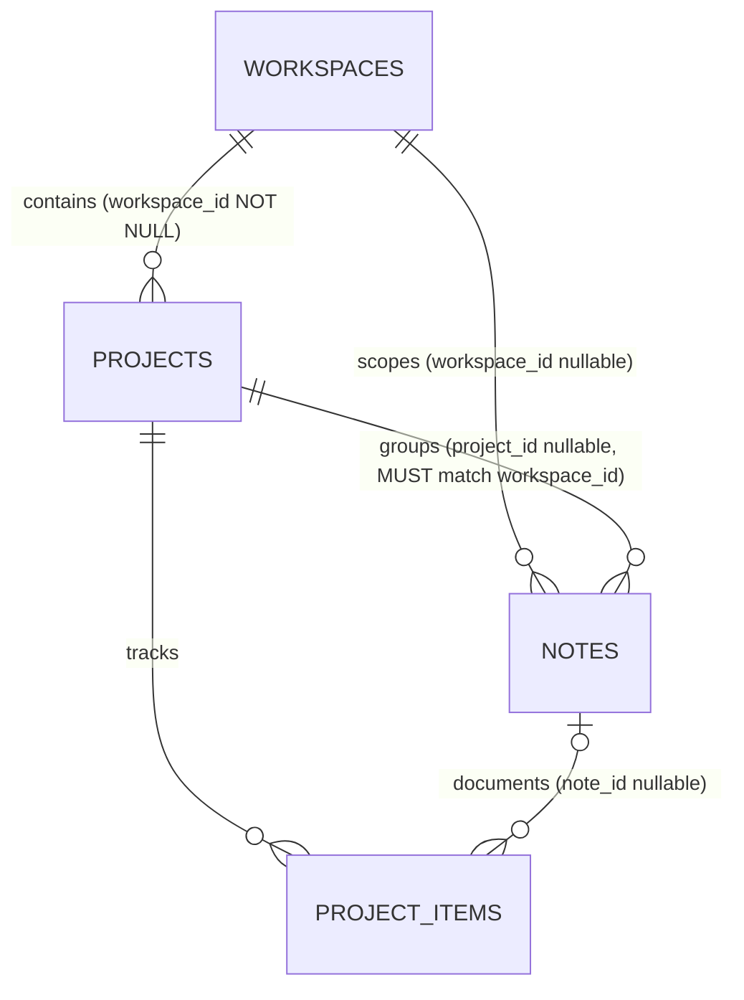

# Technical Plan: Project–Notes Integration (Workspace-Scoped Guard)

> **Status:** Draft / Planned  
> **Target Location:** [`docs/plan/project-notes-integration.md`](file:///home/farissbayu/projects/pdevlog/docs/plan/project-notes-integration.md)  
> **Target Version:** `pdevlog` v0.4+  
> **Audience:** Fullstack & Frontend Engineer  
> **Core Objective:** Enable attaching and managing Markdown **Notes** within **Projects** (`projects` $\leftrightarrow$ `notes` and `project_items.note_id`), strictly guarded at the database, worker API, and client UI layers so a note's `projectId` is always scoped to its `workspaceId` and `userId`.

---

## 1. Problem Statement & Current State

### 1.1 Current State in `pdevlog`
1. **Workspaces (`workspaces`)** group Brag Logs, Notes, and Projects.
2. **Projects (`projects`)** belong to a single Workspace (`projects.workspace_id NOT NULL`, referencing `workspaces.id` with `ON DELETE CASCADE`).
3. **Notes (`notes`)** currently only reference `workspace_id` ([`src/worker/db/schema.ts:114-139`](file:///home/farissbayu/projects/pdevlog/src/worker/db/schema.ts#L114-L139)). There is **no `project_id` column** on `notes`.
4. **Project Items (`project_items`)** already define a `note_id` column in [`src/worker/db/schema.ts:436-438`](file:///home/farissbayu/projects/pdevlog/src/worker/db/schema.ts#L436-L438), but it is currently unused across the Notes API and Project Detail UI.
5. **Project Detail Page ([`project-detail-page.tsx`](file:///home/farissbayu/projects/pdevlog/src/client/features/projects/project-detail-page.tsx))** only has two tabs (`Backlog & Plan` and `Changelog`) with no place to view or write architecture notes, spike findings, or project documentation.

### 1.2 Core Requirement: Workspace-Scoped Guard
Because every `Project` belongs to a specific `Workspace`, linking a `Note` to a `Project` introduces a relational invariant that **must** be enforced across every layer:

$$\forall \text{ Note } n:\quad n.\text{projectId} \neq \text{null} \implies n.\text{workspaceId} \neq \text{null} \;\land\; \text{Project}(n.\text{projectId}).\text{workspaceId} = n.\text{workspaceId}$$



---

## 2. Invariants & Guard Matrix

| Scenario | Input Payload (`POST /api/notes` or `PUT /api/notes/:id`) | Expected Guard Behavior | HTTP Status |
| :--- | :--- | :--- | :---: |
| **1. Standalone Note** | `{ workspace_id: null, project_id: null }` | Allowed. Note has no workspace or project. | `200` / `201` |
| **2. Workspace-Only Note** | `{ workspace_id: W1, project_id: null }` | Verify `W1` belongs to `userId`. | `200` / `201` |
| **3. Valid Workspace + Project** | `{ workspace_id: W1, project_id: P1 }` where `P1.workspaceId === W1` | Verify `W1` and `P1` belong to `userId` and `P1.workspaceId === W1`. | `200` / `201` |
| **4. Project Provided, Workspace Omitted** | `{ project_id: P1 }` (`workspace_id` omitted) | Verify `P1` belongs to `userId`; automatically derive `workspaceId = P1.workspaceId`. | `200` / `201` |
| **5. Project with Explicit `workspace_id: null`** | `{ workspace_id: null, project_id: P1 }` | **Reject:** A note cannot belong to a project while having `workspace_id: null`. | `400 Bad Request` |
| **6. Cross-Workspace Mismatch** | `{ workspace_id: W2, project_id: P1 }` where `P1.workspaceId === W1` (`W1 !== W2`) | **Reject:** `"Project does not belong to the selected workspace"`. | `400 Bad Request` |
| **7. Cross-User Project or Workspace** | `project_id` or `workspace_id` owned by another user (or non-existent) | **Reject with `404`** (never `403`, per `AGENTS.md` isolation rule). | `404 Not Found` |
| **8. Workspace Changed on Existing Note** | `PUT /api/notes/:id` with `{ workspace_id: W2 }` (or `null`), `project_id` omitted, while note had `projectId = P1` (in `W1`) | Automatically detach `projectId = null` so the note moves cleanly to `W2` without a cross-workspace project reference. | `200 OK` |
| **9. Project Deleted** | `DELETE /api/projects/:id` | `notes.project_id` is set to `NULL` (`ON DELETE SET NULL`), keeping the note safely inside its `workspace_id`. | `200 OK` |

---

## 3. Step-by-Step Architecture & Implementation Plan

### Phase 1: Database Schema & Migration

#### 1.1 Update [`src/worker/db/schema.ts`](file:///home/farissbayu/projects/pdevlog/src/worker/db/schema.ts#L114-L139)
Add `projectId` to the `notes` table definition and index `(user_id, project_id)`:

```ts
export const notes = sqliteTable(
  "notes",
  {
    id: text("id").primaryKey(),
    userId: text("user_id")
      .notNull()
      .references(() => users.id, { onDelete: "cascade" }),
    workspaceId: text("workspace_id").references(() => workspaces.id, {
      onDelete: "cascade",
    }),
    projectId: text("project_id").references(() => projects.id, {
      onDelete: "set null",
    }),
    title: text("title").notNull(),
    content: text("content").notNull(),
    createdAt: integer("created_at", { mode: "timestamp_ms" })
      .notNull()
      .default(sql`(unixepoch() * 1000)`),
    updatedAt: integer("updated_at", { mode: "timestamp_ms" })
      .notNull()
      .default(sql`(unixepoch() * 1000)`),
  },
  (table) => [
    index("notes_user_id_workspace_id_idx").on(
      table.userId,
      table.workspaceId,
    ),
    index("notes_user_id_project_id_idx").on(
      table.userId,
      table.projectId,
    ),
  ],
);
```

#### 1.2 Generate & Apply D1 Migration (`drizzle/`)
Run:
```bash
bun run db:generate
bun run db:migrate:local
```
Expected generated SQL in `drizzle/0020_*.sql`:
```sql
ALTER TABLE `notes` ADD `project_id` text REFERENCES projects(id) ON UPDATE no action ON DELETE set null;--> statement-breakpoint
CREATE INDEX `notes_user_id_project_id_idx` ON `notes` (`user_id`,`project_id`);
```

---

### Phase 2: Shared Zod Schemas (`src/shared/schemas/`)

*Per `AGENTS.md`, types flow from the worker to the client via `hc<AppType>`, so all request/response shapes must be updated in `src/shared/schemas/` first.*

#### 2.1 Update [`src/shared/schemas/notes.ts`](file:///home/farissbayu/projects/pdevlog/src/shared/schemas/notes.ts)
1. Define a lightweight `noteProjectSummarySchema`:
   ```ts
   export const noteProjectSummarySchema = z.object({
     id: z.string(),
     workspaceId: z.string(),
     name: z.string(),
     status: projectStatusSchema,
   });
   ```
2. Add `project_id` to `noteFieldsSchema` and `project_item_id` to `createNoteSchema`:
   ```ts
   const noteFieldsSchema = z.object({
     title: z.string().trim().min(1, "Title is required").max(200),
     content: z.string().trim().min(1, "Content is required").max(100000),
     workspace_id: z.string().min(1).nullable().optional(),
     project_id: z.string().min(1).nullable().optional(),
     tag_ids: z.array(z.string().min(1)).optional(),
     sources: z.array(sourceInputSchema).max(20).optional(),
   });

   export const createNoteSchema = noteFieldsSchema.extend({
     spark_id: z.string().min(1).optional(),
     project_item_id: z.string().min(1).optional(),
     carry_attachments: z.boolean().optional(),
   });
   ```
3. Add `projectId` and `project` to `noteResponseSchema`:
   ```ts
   export const noteResponseSchema = z.object({
     id: z.string(),
     title: z.string(),
     content: z.string(),
     workspaceId: z.string().nullable(),
     workspace: workspaceResponseSchema.nullable(),
     projectId: z.string().nullable(),
     project: noteProjectSummarySchema.nullable(),
     tags: z.array(tagResponseSchema),
     sources: z.array(sourceResponseSchema),
     attachments: z.array(attachmentResponseSchema),
     createdAt: z.string(),
     updatedAt: z.string(),
   });
   ```

#### 2.2 Update [`src/shared/schemas/filters.ts`](file:///home/farissbayu/projects/pdevlog/src/shared/schemas/filters.ts)
Add `project_id` to `noteFilterSchema`:
```ts
export const UNASSIGNED_WORKSPACE = "none";
export const UNASSIGNED_PROJECT = "none";

export const noteFilterSchema = baseFilterSchema.extend({
  project_id: z.string().min(1).optional(),
});
```

#### 2.3 Update [`src/shared/schemas/project.ts`](file:///home/farissbayu/projects/pdevlog/src/shared/schemas/project.ts)
Add `noteCount` to `projectResponseSchema` so project cards and the Project Detail header/tab can display the number of attached notes:
```ts
export const projectResponseSchema = z.object({
  id: z.string(),
  workspaceId: z.string(),
  name: z.string(),
  tagline: z.string().nullable(),
  description: z.string().nullable(),
  repoUrl: z.string().nullable(),
  liveUrl: z.string().nullable(),
  status: projectStatusSchema,
  backlogCount: z.number().int(),
  shippedCount: z.number().int(),
  noteCount: z.number().int(),
  createdAt: z.string(),
  updatedAt: z.string(),
});
```

---

### Phase 3: Worker API & Workspace-Scope Guard (`src/worker/features/`)

#### 3.1 Workspace-Project Guard in [`src/worker/features/notes/route.ts`](file:///home/farissbayu/projects/pdevlog/src/worker/features/notes/route.ts)

1. **Add `findOwnedProject` and Scope Resolution Helper:**
   ```ts
   async function findOwnedProject(
     db: Database,
     projectId: string,
     userId: string,
   ): Promise<ProjectRow | undefined> {
     const [project] = await db
       .select()
       .from(projects)
       .where(and(eq(projects.id, projectId), eq(projects.userId, userId)))
       .limit(1);
     return project;
   }
   ```
   ```ts
   type ScopeResolution =
     | { ok: true; workspaceId: string | null; projectId: string | null }
     | { ok: false; status: 400 | 404; error: string };

   async function resolveAndGuardNoteScope(
     db: Database,
     userId: string,
     input: {
       workspace_id?: string | null;
       project_id?: string | null;
     },
     existing?: { workspaceId: string | null; projectId: string | null },
   ): Promise<ScopeResolution> {
     // 1. Validate explicit workspace_id ownership first (404 if not owned by user)
     if (
       input.workspace_id !== undefined &&
       input.workspace_id !== null &&
       !(await validateWorkspaceOwnership(db, input.workspace_id, userId))
     ) {
       return { ok: false, status: 404, error: "Workspace not found" };
     }

     // 2. Determine target workspaceId (before project resolution)
     let targetWorkspaceId =
       input.workspace_id !== undefined
         ? input.workspace_id
         : (existing?.workspaceId ?? null);

     // 3. Determine target projectId
     let targetProjectId: string | null;
     if (input.project_id !== undefined) {
       targetProjectId = input.project_id;
     } else if (
       existing &&
       input.workspace_id !== undefined &&
       input.workspace_id !== existing.workspaceId
     ) {
       // Workspace was explicitly changed without specifying project_id -> detach old project
       targetProjectId = null;
     } else {
       targetProjectId = existing?.projectId ?? null;
     }

     // 4. Guard project ownership & workspace scope
     if (targetProjectId !== null) {
       const project = await findOwnedProject(db, targetProjectId, userId);
       if (!project) {
         return { ok: false, status: 404, error: "Project not found" };
       }

       // If workspace_id was explicitly passed as null while project_id is set -> 400
       if (input.workspace_id === null) {
         return {
           ok: false,
           status: 400,
           error: "Cannot attach a project to a note without a workspace",
         };
       }

       // If workspace_id was omitted on create/update, inherit project.workspaceId
       if (targetWorkspaceId === null && input.workspace_id === undefined) {
         targetWorkspaceId = project.workspaceId;
       }

       // Guard: Project MUST belong to targetWorkspaceId
       if (project.workspaceId !== targetWorkspaceId) {
         return {
           ok: false,
           status: 400,
           error: "Project does not belong to the selected workspace",
         };
       }
     }

     return {
       ok: true,
       workspaceId: targetWorkspaceId,
       projectId: targetProjectId,
     };
   }
   ```

2. **Guard Optional `project_item_id` in `createNoteHandler`:**
   - If `input.project_item_id` is passed:
     - Query `projectItems` by `and(eq(projectItems.id, projectItemId), eq(projectItems.userId, userId))`. If missing $\rightarrow$ `404 Project item not found`.
     - If `scope.projectId && ownedItem.projectId !== scope.projectId` $\rightarrow$ `400 Project item does not belong to the selected project`.
     - Update `projectItems.noteId = noteId` in `db.batch(...)`.

3. **Filter & Join Projects in `listNotes` (`GET /api/notes`):**
   - Add filter condition for `filters.project_id`:
     ```ts
     if (filters.project_id === UNASSIGNED_PROJECT) {
       conditions.push(isNull(notes.projectId));
     } else if (filters.project_id) {
       conditions.push(eq(notes.projectId, filters.project_id));
     }
     ```
   - Left-join `projects` in `listNotes`:
     ```ts
     .leftJoin(
       projects,
       and(
         eq(notes.projectId, projects.id),
         eq(projects.userId, userId),
       ),
     )
     ```
   - Map `row.project` into `toNoteResponse` as `{ id, workspaceId, name, status } | null`.

4. **Touch `projects.updatedAt` on Note Create / Update / Delete:**
   - Alongside `touchWorkspaceStatement`, add `touchProjectStatement(db, projectId, userId, now)` when a note is created in, moved into/out of, or deleted from a project.

#### 3.2 Add `noteCount` to [`src/worker/features/projects/route.ts`](file:///home/farissbayu/projects/pdevlog/src/worker/features/projects/route.ts)
Extend `loadItemCounts` (or add `loadNoteCounts`) in `projects/route.ts` to query `count()` from `notes` grouped by `notes.projectId` where `eq(notes.userId, userId)` and `inArray(notes.projectId, projectIds)`, returning `noteCount` in `toProjectResponse`.

---

### Phase 4: Client UI & Workspace-Scoped Guards (`src/client/`)

#### 4.1 URL Filter State & `FilterBar` — [`use-filter-params.ts`](file:///home/farissbayu/projects/pdevlog/src/client/lib/use-filter-params.ts) & [`filter-bar.tsx`](file:///home/farissbayu/projects/pdevlog/src/client/components/filter-bar.tsx)
1. **`use-filter-params.ts`:**
   - Add `projectId: string` to `FilterParams` and `setProjectId: (value: string) => void` to `FilterParamsApi`.
   - Include `if (filters.projectId) query.project_id = filters.projectId` in `buildFilterQuery`.
   - **Client Scope Guard:** In `setWorkspaceId(value)`, also clear `next.delete("projectId")` so switching workspaces on `/notes` automatically resets any active project filter from the previous workspace.
2. **`filter-bar.tsx`:**
   - Accept `projects?: ProjectResponse[]`.
   - Render a **Project** dropdown (`All projects`, `Unassigned`, and the list of projects) **only when**:
     - `projects` is provided AND `filters.workspaceId` is set to a specific workspace (not `""` and not `"none"`), OR when `FilterBar` is used inside a fixed-workspace context.
   - In [`notes-page.tsx`](file:///home/farissbayu/projects/pdevlog/src/client/features/notes/notes-page.tsx): call `useProjectsQuery(filterApi.filters.workspaceId !== UNASSIGNED_WORKSPACE ? filterApi.filters.workspaceId : "")` and pass `projects` into `<FilterBar />`.

#### 4.2 Workspace-Scoped Project Selector in Note Editor — [`src/client/features/notes/note-editor.tsx`](file:///home/farissbayu/projects/pdevlog/src/client/features/notes/note-editor.tsx)
1. **State & Query Params:**
   - Read `presetWorkspaceId = searchParams.get("workspace") ?? ""`, `presetProjectId = searchParams.get("project") ?? ""`, and `projectItemId = searchParams.get("projectItem") ?? ""`.
   - Initialize `projectId` state from `note?.projectId ?? presetProjectId ?? ""`.
   - Fetch workspace-scoped projects via `useProjectsQuery(workspaceId)` (which is only enabled when `Boolean(workspaceId)`).
2. **Client-Side Workspace Scope Guards:**
   - **On Workspace Change:** When the user changes the Workspace `<Select>`, immediately clear `projectId`:
     ```tsx
     onValueChange={(value) => {
       const nextWorkspaceId = value === "none" ? "" : value;
       setWorkspaceId(nextWorkspaceId);
       setProjectId("");
     }}
     ```
   - **Disabled State When No Workspace:** When `!workspaceId`, the Project `<Select>` is `disabled` with placeholder `"Select a workspace first"`.
   - **Stale/Invalid Preset Guard:** Once `workspaceProjects` finishes loading for `workspaceId`, if `projectId` is non-empty and not found in `workspaceProjects`, reset `setProjectId("")`.
3. **Layout in `NoteEditorForm`:**
   - Change the metadata row from `sm:grid-cols-2` (`Workspace`, `Tags`) to `sm:grid-cols-3` (`Workspace`, `Project`, `Tags`).
   - Include `project_id: workspaceId ? (projectId || null) : null` (and `project_item_id` when creating from a project item) in the submit payload.
   - Update `backTo` so creating/editing a note from a project returns to `/workspaces/${workspaceId}/projects/${projectId}?tab=notes`.

#### 4.3 Add "Notes" Tab & Item-Note Linking in [`src/client/features/projects/project-detail-page.tsx`](file:///home/farissbayu/projects/pdevlog/src/client/features/projects/project-detail-page.tsx)
1. **Tabs:**
   - Extend tab state to `"backlog" | "changelog" | "notes"` (initialized from `?tab=notes` query param if present):
     - `Backlog & Plan (${backlogItems.length})`
     - `Changelog (${shippedItems.length})`
     - `Notes (${project.noteCount})`
2. **Notes Tab View:**
   - Query notes via `useNotesQuery({ ...EMPTY_FILTERS, workspaceId: project.workspaceId, projectId: project.id, q: notesSearch, page: notesPage })`.
   - Render a header bar with search input and a **"New note"** button linking to:
     `/notes/new?workspace=${project.workspaceId}&project=${project.id}`
   - Render `<NoteList notes={projectNotes} />`, `<PaginationControls />`, and an empty state with a CTA to create the first project note.
3. **Backlog / Changelog Item $\leftrightarrow$ Note Link (`project_items.note_id`):**
   - If `item.noteId` is present, show a `<Link to={`/notes/${item.noteId}`}>` badge (`Note`).
   - Add an action button (`Write note` / `NotebookPen` icon) on project items that navigates to `/notes/new?workspace=${project.workspaceId}&project=${project.id}&projectItem=${item.id}`.

#### 4.4 Display Project Context in [`note-list.tsx`](file:///home/farissbayu/projects/pdevlog/src/client/features/notes/note-list.tsx) & [`note-detail-page.tsx`](file:///home/farissbayu/projects/pdevlog/src/client/features/notes/note-detail-page.tsx)
1. **`NoteList` Card Metadata:**
   - When `note.project` is present, render a project indicator with a `Rocket` icon (`<span className="inline-flex items-center gap-1 truncate"><Rocket className="size-3 shrink-0" />{note.project.name}</span>`) right after the workspace name.
2. **`NoteDetailPage` Breadcrumb & Metadata:**
   - In the top back-link: if `data.workspace && data.project`, render breadcrumb links to both the Workspace and the Project (`/workspaces/${data.workspace.id}/projects/${data.project.id}?tab=notes`).
   - In the metadata bar below `<h1>`: display a clickable `<Link to={`/workspaces/${data.workspaceId}/projects/${data.project.id}`}>` chip with `<Rocket className="size-3.5" /> {data.project.name}`.
   - On note deletion: if `data.project && data.workspace`, navigate back to `/workspaces/${data.workspace.id}/projects/${data.project.id}?tab=notes`.

#### 4.5 Query Invalidation — [`src/client/features/notes/api.ts`](file:///home/farissbayu/projects/pdevlog/src/client/features/notes/api.ts)
In `useCreateNoteMutation`, `useUpdateNoteMutation`, and `useDeleteNoteMutation`, invalidate `queryClient.invalidateQueries({ queryKey: ["projects"] })` so `project.noteCount` and project item `noteId` links stay in sync.

---

## 4. Isolation & Guard Test Plan (`tests/isolation/notes.test.ts`)

Add dedicated test cases to [`tests/isolation/notes.test.ts`](file:///home/farissbayu/projects/pdevlog/tests/isolation/notes.test.ts) covering all workspace-scope and user-isolation invariants:

1. **Attach Note to Owned Project in Same Workspace (`201`):**
   - Create `workspaceA` and `projectA` (in `workspaceA`).
   - `POST /api/notes` with `{ workspace_id: workspaceA, project_id: projectA }` $\rightarrow$ `201`, `note.workspaceId === workspaceA`, `note.projectId === projectA`, `note.project.name === "pdevlog"`.
2. **Auto-Derive Workspace from Project When `workspace_id` Omitted (`201`):**
   - `POST /api/notes` with `{ project_id: projectA }` $\rightarrow$ `201`, `note.workspaceId === workspaceA`.
3. **Reject Cross-Workspace Project Assignment (`400`):**
   - Same user creates `workspaceA` (with `projectA`) and `workspaceB`.
   - `POST /api/notes` with `{ workspace_id: workspaceB, project_id: projectA }` $\rightarrow$ `400 Bad Request`.
   - `PUT /api/notes/:id` on a note in `workspaceB` with `{ project_id: projectA }` $\rightarrow$ `400 Bad Request`.
4. **Reject Project with `workspace_id: null` (`400`):**
   - `POST /api/notes` with `{ workspace_id: null, project_id: projectA }` $\rightarrow$ `400 Bad Request`.
5. **Reject Cross-User Project Access (`404`, Never `403`):**
   - `userA` owns `workspaceA` and `projectA`; `userB` owns `workspaceB`.
   - `userB` calls `POST /api/notes` with `{ workspace_id: workspaceB, project_id: projectA }` $\rightarrow$ `404 Not Found`.
   - `userB` calls `POST /api/notes` with `{ project_id: projectA }` $\rightarrow$ `404 Not Found`.
6. **Auto-Detach Project When Note Moves to Another Workspace (`200`):**
   - Note is in `workspaceA` + `projectA`.
   - `PUT /api/notes/:id` with `{ workspace_id: workspaceB }` (without `project_id`) $\rightarrow$ `200`, `note.workspaceId === workspaceB`, `note.projectId === null`.
7. **Filter Notes by `project_id` & Verify `ON DELETE SET NULL`:**
   - `GET /api/notes?workspace_id=${workspaceA}&project_id=${projectA}` returns only notes in `projectA`.
   - `DELETE /api/projects/${projectA}` $\rightarrow$ note still exists in `workspaceA` with `projectId: null`.

---

## 5. Rollout Order & Verification Checklist

1. [ ] **Schema & Migration:** Edit [`src/worker/db/schema.ts`](file:///home/farissbayu/projects/pdevlog/src/worker/db/schema.ts) $\rightarrow$ `bun run db:generate` $\rightarrow$ `bun run db:migrate:local`.
2. [ ] **Shared Schemas:** Update [`notes.ts`](file:///home/farissbayu/projects/pdevlog/src/shared/schemas/notes.ts), [`filters.ts`](file:///home/farissbayu/projects/pdevlog/src/shared/schemas/filters.ts), and [`project.ts`](file:///home/farissbayu/projects/pdevlog/src/shared/schemas/project.ts).
3. [ ] **Worker Routes:** Update [`src/worker/features/notes/route.ts`](file:///home/farissbayu/projects/pdevlog/src/worker/features/notes/route.ts) and [`src/worker/features/projects/route.ts`](file:///home/farissbayu/projects/pdevlog/src/worker/features/projects/route.ts).
4. [ ] **Client Hooks & UI:** Update [`use-filter-params.ts`](file:///home/farissbayu/projects/pdevlog/src/client/lib/use-filter-params.ts), [`filter-bar.tsx`](file:///home/farissbayu/projects/pdevlog/src/client/components/filter-bar.tsx), [`notes/api.ts`](file:///home/farissbayu/projects/pdevlog/src/client/features/notes/api.ts), [`note-editor.tsx`](file:///home/farissbayu/projects/pdevlog/src/client/features/notes/note-editor.tsx), [`note-list.tsx`](file:///home/farissbayu/projects/pdevlog/src/client/features/notes/note-list.tsx), [`note-detail-page.tsx`](file:///home/farissbayu/projects/pdevlog/src/client/features/notes/note-detail-page.tsx), and [`project-detail-page.tsx`](file:///home/farissbayu/projects/pdevlog/src/client/features/projects/project-detail-page.tsx).
5. [ ] **Tests & Static Analysis:**
   - `bun run typecheck`
   - `bun run lint`
   - `bunx vitest run tests/isolation/notes.test.ts tests/isolation/projects.test.ts`

