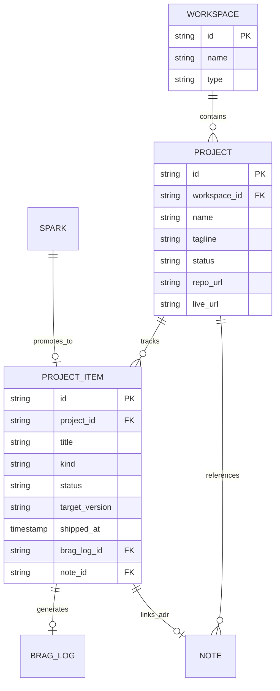

# Technical & Product Plan: Projects, Backlog & Changelog System

> **Status:** Draft / Planned  
> **Audience:** Solo Software Engineer / Indie Hacker / Builder  
> **Core Objective:** Menghubungkan ide mentah (*Spark*) dengan eksekusi nyata melalui sistem **Backlog & Changelog** yang *developer-first* (berorientasi pada siklus rilis software, bukan *project management* birokratis ala Jira), serta mengalirkan hasil rilis (*Shipped*) langsung menjadi draf pencapaian (*STAR Brag Log*).

---

## 1. Problem Statement & Filosofi Desain

### 1.1 Masalah Saat Ini di `pdevlog`
Saat ini `pdevlog` memiliki:
* **Sparks**: Penangkap ide kilat dan inspirasi spontan (*frictionless capture*).
* **Notes**: Dokumentasi pengetahuan, ADR (Architecture Decision Record), dan riset.
* **Brag Logs**: Dokumentasi pencapaian masa lalu dalam format STAR (Situation, Task, Action, Result).
* **Workspaces**: Kontainer makro konteks (`work`, `learning`, `general`).

**Missing Link:** Tidak ada wadah untuk **proses eksekusi software**:
1. Sebuah aplikasi (seperti `pdevlog` itu sendiri) terdiri dari serangkaian ide, rencana rilis (*roadmap*), dan riwayat perbaikan yang berkesinambungan.
2. Ketika developer mendapatkan ide fitur, saat ini ide tersebut terhenti di Spark atau tercecer di Notes tanpa ada status apakah ide tersebut direncanakan (*Planned*), sedang dikerjakan (*In Progress*), atau sudah dirilis (*Shipped*).
3. Saat sebuah fitur selesai di-*ship*, developer harus mengingat-ingat dan mengetik ulang dari nol ke Brag Log.

### 1.2 Filosofi: "Backlog $\to$ Changelog" (Bukan Project Management)
Developer solo tidak membutuhkan:
* ❌ Kanban board dengan 6 kolom kaku yang memicu rasa lelah memindahkan kartu.
* ❌ Story points, sprint burndown, estimasi jam, atau poker planning.
* ❌ Tiket dengan form birokratis 15 kolom.

Developer menyukai dan terbiasa dengan:
* ✅ **Backlog / Roadmap Dokumen:** Daftar rencana rilis yang dikelompokkan berdasarkan target versi/fase (`Next / v0.3`, `v1.0`, `Icebox`).
* ✅ **Changelog History:** Riwayat apa saja yang sudah di-*ship* per versi (`Added`, `Fixed`, `Improved`, `Perf`).
* ✅ **Dopamin Rilis:** Menandai item selesai lalu melihat timeline rilis bertambah panjang.
* ✅ **1-Click Export & Brag:** Mengubah item rilis menjadi release note Markdown untuk GitHub Releases, atau menjadikannya STAR Brag Log untuk portofolio dan review karier.

---

## 2. Arsitektur Relasi Entitas (Hierarchy)

Sesuai **Opsi A**, `Project` adalah anak dari `Workspace`. Setiap Workspace dapat menampung beberapa Project (misal: Workspace *"Side Hustles"* menampung Project *"pdevlog"*, *"portfolio-v2"*, dsb).



---

## 3. Alur Pengguna (User Workflows)

### 3.1 Alur 1: Dari Spark ke Backlog Item
1. Developer sedang bekerja/browsing dan mendapat ide: *"Tambahkan semantic search via Cloudflare Vectorize"*.
2. Tekan `Cmd+K` $\rightarrow$ Simpan di **Spark**.
3. Di kemudian hari saat *grooming* ide: Buka Spark $\rightarrow$ Klik **"Promote to Project Backlog"**.
4. Pilih Project: `pdevlog` $\rightarrow$ Tentukan Target Version: `v0.4 (Future)` $\rightarrow$ Kind: `feat`.
5. Spark ditandai `promoted` dan item otomatis masuk ke daftar Backlog proyek.

### 3.2 Alur 2: Eksekusi Backlog & Fast Capture
1. Developer membuka Workspace $\rightarrow$ Pilih Project `pdevlog`.
2. Pada tab **Backlog / Roadmap**, developer dapat dengan cepat menambahkan item satu baris:
   * Ketik judul $\rightarrow$ Enter (cepat seperti mengetik todo list).
   * Pilih kategori changelog dengan shortcut atau dropdown: `feat` (Fitur baru), `fix` (Bug fix), `perf` (Optimasi), `refactor`, `spike` (Riset/Eksperimen).
3. Status item:
   * `backlog` (Belum disentuh)
   * `in_progress` (Sedang dikerjakan)
   * `shipped` (Sudah selesai dan dirilis)

### 3.3 Alur 3: Shipped $\to$ Auto-Changelog $\to$ STAR Brag Log
1. Ketika fitur selesai dan di-deploy: Klik tombol **"Mark as Shipped"** pada item backlog.
2. Item berpindah secara instan dari tab **Backlog** ke tab **Changelog** di bawah versi rilis terkait (misal: `v0.3.0`).
3. Pada item di Changelog, terdapat tombol **"Log as STAR"**:
   * Sistem otomatis membuka dialog draf Brag Log dengan isian awal:
     * **Title**: Diambil dari judul item.
     * **Situation**: Nama project & konteks milestone.
     * **Task**: Deskripsi/kategori item (`feat`/`perf`/`fix`).
     * **Action**: Terhubung dengan Note/ADR terkait jika ada.
     * **Result**: Tempat developer mengisi metrik/dampak hasil rilis.
4. Begitu disimpan, item di Changelog memiliki badge tautan langsung ke Brag Log terkait (`🏆 Brag Logged`).

---

## 4. Spesifikasi Database & Schema Drizzle

### 4.1 Tabel Baru: `projects`
```typescript
export const projectStatuses = ["active", "maintenance", "archived"] as const;
export type ProjectStatus = (typeof projectStatuses)[number];

export const projects = sqliteTable(
  "projects",
  {
    id: text("id").primaryKey(),
    userId: text("user_id")
      .notNull()
      .references(() => users.id, { onDelete: "cascade" }),
    workspaceId: text("workspace_id")
      .notNull()
      .references(() => workspaces.id, { onDelete: "cascade" }),
    name: text("name").notNull(),
    tagline: text("tagline"),
    description: text("description"),
    repoUrl: text("repo_url"),
    liveUrl: text("live_url"),
    status: text("status", { enum: projectStatuses })
      .notNull()
      .default("active"),
    createdAt: integer("created_at", { mode: "timestamp_ms" })
      .notNull()
      .default(sql`(unixepoch() * 1000)`),
    updatedAt: integer("updated_at", { mode: "timestamp_ms" })
      .notNull()
      .default(sql`(unixepoch() * 1000)`),
  },
  (table) => [
    index("projects_user_id_workspace_id_idx").on(table.userId, table.workspaceId),
    index("projects_user_id_status_idx").on(table.userId, table.status),
  ]
);
```

### 4.2 Tabel Baru: `project_items`
```typescript
export const projectItemKinds = [
  "feat",      // New feature (Added)
  "fix",       // Bug fix (Fixed)
  "perf",      // Performance enhancement
  "refactor",  // Code refactoring / Architecture cleanup
  "spike",     // Research / POC / Exploration
  "docs",      // Documentation / ADR
] as const;
export type ProjectItemKind = (typeof projectItemKinds)[number];

export const projectItemStatuses = [
  "backlog",     // Planned / In queue
  "in_progress", // Currently being built
  "shipped",     // Done & Released to Changelog
  "dropped",     // Cancelled / No longer needed
] as const;
export type ProjectItemStatus = (typeof projectItemStatuses)[number];

export const projectItems = sqliteTable(
  "project_items",
  {
    id: text("id").primaryKey(),
    userId: text("user_id")
      .notNull()
      .references(() => users.id, { onDelete: "cascade" }),
    projectId: text("project_id")
      .notNull()
      .references(() => projects.id, { onDelete: "cascade" }),
    title: text("title").notNull(),
    description: text("description"),
    kind: text("kind", { enum: projectItemKinds })
      .notNull()
      .default("feat"),
    status: text("status", { enum: projectItemStatuses })
      .notNull()
      .default("backlog"),
    targetVersion: text("target_version").notNull().default("Next"),
    position: integer("position").notNull().default(0),
    shippedAt: integer("shipped_at", { mode: "timestamp_ms" }),
    shippedVersion: text("shipped_version"),
    bragLogId: text("brag_log_id").references(() => bragLogs.id, {
      onDelete: "set null",
    }),
    noteId: text("note_id").references(() => notes.id, {
      onDelete: "set null",
    }),
    createdAt: integer("created_at", { mode: "timestamp_ms" })
      .notNull()
      .default(sql`(unixepoch() * 1000)`),
    updatedAt: integer("updated_at", { mode: "timestamp_ms" })
      .notNull()
      .default(sql`(unixepoch() * 1000)`),
  },
  (table) => [
    index("project_items_user_id_project_id_idx").on(table.userId, table.projectId),
    index("project_items_project_id_status_idx").on(table.projectId, table.status),
    index("project_items_project_id_target_version_idx").on(table.projectId, table.targetVersion),
  ]
);
```

### 4.3 Update Relasi yang Ada:
* Tambahkan `"project-item"` ke `sparkPromotionTypes` di tabel `sparks` (`"brag-log" | "note" | "workspace" | "project-item"`).
* (Opsional masa depan) Tambahkan `projectId` opsional di tabel `notes` dan `brag_logs` untuk filtering cepat per project.

---

## 5. Spesifikasi API Endpoints (Hono Worker)

Semua route dilindungi oleh auth middleware session (`userId`).

### 5.1 Project Routes (`/api/projects`)
* `GET /api/projects?workspaceId=...` — List project dalam workspace (termasuk ringkasan total backlog dan total shipped).
* `POST /api/projects` — Buat project baru.
* `GET /api/projects/:id` — Detail project (metadata, statistik, daftar milestone).
* `PATCH /api/projects/:id` — Update nama, tagline, status, link GitHub/demo.
* `DELETE /api/projects/:id` — Hapus project (cascade items).

### 5.2 Backlog & Changelog Routes (`/api/projects/:id/items`)
* `GET /api/projects/:id/items?status=backlog|in_progress|shipped` — Mengambil daftar item:
  * Jika query status `backlog` / `in_progress` $\rightarrow$ Dikelompokkan berdasarkan `targetVersion`.
  * Jika query status `shipped` $\rightarrow$ Dikelompokkan berdasarkan `shippedVersion` dan urutan tanggal `shippedAt DESC` (tampilan Changelog).
* `POST /api/projects/:id/items` — Quick-add item baru ke backlog.
* `PATCH /api/projects/:id/items/:itemId` — Update judul, deskripsi, kind, targetVersion, atau posisi.
* `POST /api/projects/:id/items/:itemId/ship` — Endpoint aksi rilis:
  * Mengubah status menjadi `shipped`.
  * Mengisi `shippedAt` dengan waktu saat ini.
  * Menetapkan `shippedVersion` (default ke `targetVersion`).
* `POST /api/projects/:id/items/:itemId/create-brag` — Auto-draft dan hubungkan item rilis ke form STAR Brag Log.
* `DELETE /api/projects/:id/items/:itemId` — Hapus item.

### 5.3 Export Changelog (`/api/projects/:id/changelog/export`)
* `GET /api/projects/:id/changelog/export?format=markdown` — Menghasilkan format raw Markdown standar `CHANGELOG.md` yang siap di-copy ke repo GitHub atau Release notes:
  ```markdown
  # Changelog - pdevlog

  ## [v0.2.0] - 2026-10-10
  ### Added
  - Skill Shredder: breakdown fundamental tech topics into toy projects
  - Cloudflare R2 screenshot attachments for Sparks and Notes
  
  ### Changed
  - Landing page refreshed with the capture -> learn -> log flywheel
  ```

---

## 6. Desain Antarmuka (UI/UX Frontend)

### 6.1 Posisi Menu di Navigasi
1. **Di Sidebar:** Pada bagian *Workspaces*, ketika user membuka detail Workspace, terdapat tab/sub-nav:
   * **Projects** (Baru)
   * **Notes**
   * **Brag Logs**
   * **Sources**
2. **Dashboard:** Widget baru *"Active Projects"* yang memperlihatkan progres rilis terkini.

### 6.2 Halaman Project Detail (`/workspaces/:wsId/projects/:projectId`)

```
┌────────────────────────────────────────────────────────────────────────┐
│  ← Back to Workspace                                                   │
│                                                                        │
│  🚀 pdevlog                                [ Active ]  [ + New Item ] │
│  Personal dev log for software engineers                               │
│  GitHub: github.com/user/pdevlog  •  Live: pdevlog.dev                │
│                                                                        │
│  ┌──────────────────────┬──────────────────────┬────────────────────┐  │
│  │  📋 Backlog & Plan   │  📦 Changelog (14)   │  📝 Related Notes  │  │
│  └──────────────────────┴──────────────────────┴────────────────────┘  │
│                                                                        │
│  [ + Quick Add Item: Type title and press Enter...          [feat ▾] ] │
│                                                                        │
│  ▼ 🎯 Next (v0.3.0) — 3 items                                          │
│    [ ] feat     Project & Changelog Tracking              [ Ship ] ... │
│    [/] feat     AI Socratic Sparring Partner (In Prog)    [ Ship ] ... │
│    [ ] perf     D1 Query Batching for Dashboard           [ Ship ] ... │
│                                                                        │
│  ▼ 💡 Future / Icebox — 2 items                                        │
│    [ ] spike    Semantic Search with Cloudflare Vectorize              │
│    [ ] feat     1-Click Full Data Export (.zip)                        │
└────────────────────────────────────────────────────────────────────────┘
```

### 6.3 Komponen UI Khusus
1. **Kind Chip Badges**:
   * `feat`: Biru / Hijau (`#3b82f6` / `#10b981`)
   * `fix`: Merah (`#ef4444`)
   * `perf`: Kuning/Oranye (`#f59e0b`)
   * `refactor`: Ungu (`#8b5cf6`)
   * `spike`: Cyan / Indigo (`#06b6d4`)
2. **Quick Ship Action**: Tombol roket kecil `[ 🚀 Ship ]` di sebelah tiap item backlog, yang memunculkan konfirmasi cepat: *"Ship to v0.3.0?"*.
3. **Changelog View**: Tampilan timeline vertikal bersih dan elegan, dengan *copy Markdown* di tiap header rilis.

---

## 7. Rencana Tahapan Eksekusi (Implementation Milestones)

| Fase | Fokus | Output Utama |
|---|---|---|
| **Fase 1** | **Database & Shared Schemas** | Schema `projects` & `project_items` di Drizzle, file Zod schemas di `src/shared/schemas/project.ts`, migration D1 Drizzle. |
| **Fase 2** | **Backend API & Integration** | Route Hono di `src/worker/features/projects/route.ts`, unit & integration tests API, extend `sparks` promote handler. |
| **Fase 3** | **Frontend Core: Project & Backlog** | Project List di Workspace Detail, halaman Project Detail, Backlog grouped list, quick item input. |
| **Fase 4** | **Changelog & Brag Connection** | Tab Changelog vertikal, aksi `Ship`, dialog 1-click `Create STAR Brag Log`, copy/export `CHANGELOG.md`. |

---

## 8. Anti-Overwhelm Guardrails

Untuk menjaga agar fitur ini tetap *lightweight* dan tidak memberatkan mental:
1. **Maksimal 3 Status**: Hanya `backlog`, `in_progress`, dan `shipped` (ditambah opsi `dropped` untuk membersihkan ide basi).
2. **Auto-Clean Icebox**: Jika sebuah item berada di Backlog lebih dari 30 hari tanpa disentuh, pdevlog menampilkan tombol cepat: *"Keep, Slice, or Drop?"* agar backlog tidak menjadi kuburan ide.
3. **Markdown-First Feel**: Antarmuka responsif dan cepat, serasa mengetik dokumen teks biasa dengan kapabilitas database relasional.

