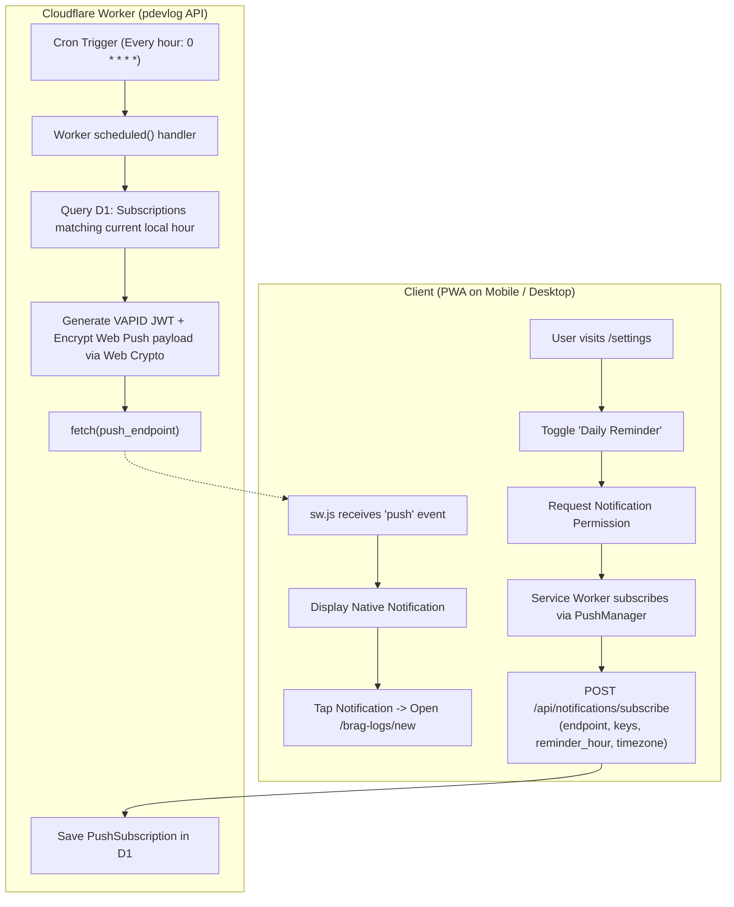

# Implementation Plan: PWA & Web Push Daily Reminders | NOT IMPLEMENTED

**Status:** Proposed  
**Feature Surface:** PWA Installability + Settings UI (`/settings`) + Worker Scheduler (`scheduled`) + Notification Routes (`/api/notifications/*`)  
**Runtime:** Cloudflare Workers (Cron Triggers + D1 + Web Crypto API)  
**Frontend:** React 19 + React Query + Lucide Icons + Tailwind CSS v4 + Service Worker

---

## 1. Executive Summary & Architecture Overview

### 1.1 Context & Problem

`pdevlog` serves as an autonomous engineering log and career vault. Daily consistency is critical for capturing wins, learnings, and STAR logs while memories are fresh. Users want to be reminded at a specific hour on their mobile devices ("notifikasikan aku setiap jam X"), but without requiring a separate native mobile app (App Store/Play Store build).

### 1.2 The Solution

Convert `pdevlog` into an installable **Progressive Web App (PWA)** with **Web Push Notifications**:

1. **PWA Standalone Shell:** Adds a Web App Manifest (`manifest.webmanifest`), app icons (192px/512px), and Service Worker to make the app installable to the home screen on iOS, Android, macOS, and Windows.
2. **Push Notification Support:** Implements standard W3C Push API with VAPID keys. On iOS 16.4+, PWA standalone mode unlocks native lock-screen notifications.
3. **Cron-Based Reminder Engine:** Cloudflare Workers' `scheduled` cron trigger runs every hour, checks user reminder preferences against their local timezones in D1, and sends encrypted Web Push payloads directly to browser push endpoints.
4. **Immediate Verification:** Users can trigger an instant test notification from the Settings page to verify their device connection.

---

## 2. High-Level Architecture Diagram



---

## 3. Database Schema & Migration (`src/worker/db/schema.ts`)

A dedicated `push_subscriptions` table tracks active device subscriptions per user, supporting multi-device notifications (e.g. phone + laptop) with per-user isolation.

### 3.1 D1 Table Definition

```ts
export const pushSubscriptions = sqliteTable(
  "push_subscriptions",
  {
    id: text("id").primaryKey(), // nanoid
    userId: text("user_id")
      .notNull()
      .references(() => users.id, { onDelete: "cascade" }),
    endpoint: text("endpoint").notNull().unique(),
    p256dh: text("p256dh").notNull(), // client public key
    auth: text("auth").notNull(), // client auth secret
    reminderHour: integer("reminder_hour").notNull().default(20), // 0 to 23
    timezone: text("timezone").notNull().default("Asia/Jakarta"),
    isActive: integer("is_active", { mode: "boolean" }).notNull().default(true),
    userAgent: text("user_agent"),
    lastNotifiedAt: integer("last_notified_at", { mode: "timestamp_ms" }),
    createdAt: integer("created_at", { mode: "timestamp_ms" })
      .notNull()
      .default(sql`(unixepoch() * 1000)`),
    updatedAt: integer("updated_at", { mode: "timestamp_ms" })
      .notNull()
      .default(sql`(unixepoch() * 1000)`),
  },
  (table) => [
    index("push_subscriptions_user_id_idx").on(table.userId),
    index("push_subscriptions_active_idx").on(
      table.isActive,
      table.reminderHour,
    ),
  ],
);
```

### 3.2 Migration Strategy

1. Add `pushSubscriptions` to `src/worker/db/schema.ts`.
2. Run `bun run db:generate` to generate Drizzle SQL migration.
3. Apply locally with `bun run db:migrate:local`.

---

## 4. Shared Schemas (`src/shared/schemas/notifications.ts`)

Strict Zod schemas shared between the client and worker (following AGENTS.md conventions):

```ts
import { z } from "zod";

export const saveSubscriptionSchema = z.object({
  endpoint: z.string().url(),
  keys: z.object({
    p256dh: z.string().min(1),
    auth: z.string().min(1),
  }),
  reminderHour: z.number().int().min(0).max(23).default(20),
  timezone: z.string().min(1).default("Asia/Jakarta"),
});

export type SaveSubscriptionInput = z.infer<typeof saveSubscriptionSchema>;

export const updateReminderSettingsSchema = z.object({
  reminderHour: z.number().int().min(0).max(23),
  timezone: z.string().min(1),
  isActive: z.boolean(),
});

export type UpdateReminderSettingsInput = z.infer<
  typeof updateReminderSettingsSchema
>;

export const notificationSettingsResponseSchema = z.object({
  hasSubscription: z.boolean(),
  reminderHour: z.number().int().min(0).max(23),
  timezone: z.string(),
  isActive: z.boolean(),
  deviceCount: z.number().int(),
});

export type NotificationSettingsResponse = z.infer<
  typeof notificationSettingsResponseSchema
>;
```

---

## 5. Web App Manifest & PWA Assets

### 5.1 Manifest (`public/manifest.webmanifest`)

Provides metadata for browsers to offer installation and launch standalone without browser bars:

```json
{
  "name": "Personal Dev Log",
  "short_name": "pdevlog",
  "description": "Capture brag-worthy wins, STAR logs, notes, and career growth.",
  "start_url": "/",
  "scope": "/",
  "display": "standalone",
  "background_color": "#09090b",
  "theme_color": "#09090b",
  "icons": [
    {
      "src": "/icons/pdevlog-192.png",
      "sizes": "192x192",
      "type": "image/png",
      "purpose": "any"
    },
    {
      "src": "/icons/pdevlog-512.png",
      "sizes": "512x512",
      "type": "image/png",
      "purpose": "any"
    },
    {
      "src": "/icons/pdevlog-maskable-512.png",
      "sizes": "512x512",
      "type": "image/png",
      "purpose": "maskable"
    }
  ]
}
```

### 5.2 Header Links in `index.html`

Ensure iOS Safari detects PWA capabilities properly:

```html
<link rel="manifest" href="/manifest.webmanifest" />
<meta name="apple-mobile-web-app-capable" content="yes" />
<meta
  name="apple-mobile-web-app-status-bar-style"
  content="black-translucent" />
<meta name="apple-mobile-web-app-title" content="pdevlog" />
<link rel="apple-touch-icon" href="/icons/pdevlog-192.png" />
<meta name="theme-color" content="#09090b" />
```

### 5.3 Service Worker (`public/sw.js`)

Handles background push events and notification interactions:

```js
// public/sw.js
self.addEventListener("install", (event) => {
  self.skipWaiting();
});

self.addEventListener("activate", (event) => {
  event.waitUntil(self.clients.claim());
});

self.addEventListener("push", (event) => {
  if (!event.data) return;

  try {
    const payload = event.data.json();
    const title = payload.title || "pdevlog Reminder";
    const options = {
      body:
        payload.body || "Waktunya mencatat dev log dan pencapaian hari ini!",
      icon: payload.icon || "/icons/pdevlog-192.png",
      badge: "/icons/pdevlog-badge.png",
      data: {
        url: payload.url || "/brag-logs/new",
      },
      tag: payload.tag || "daily-reminder",
      renotify: true,
    };

    event.waitUntil(self.registration.showNotification(title, options));
  } catch (err) {
    console.error("Failed to parse push event payload", err);
  }
});

self.addEventListener("notificationclick", (event) => {
  event.notification.close();
  const targetUrl = event.notification.data?.url || "/";

  event.waitUntil(
    clients
      .matchAll({ type: "window", includeUncontrolled: true })
      .then((windowClients) => {
        for (const client of windowClients) {
          if (client.url.includes(targetUrl) && "focus" in client) {
            return client.focus();
          }
        }
        if (clients.openWindow) {
          return clients.openWindow(targetUrl);
        }
      }),
  );
});
```

---

## 6. Web Push Encryption & VAPID on Cloudflare Workers

Sending Web Push messages requires RFC 8291 (message encryption using ECDH + HKDF + AES-128-GCM) and RFC 8292 (VAPID JWT using ECDSA P-256).

### 6.1 VAPID Keys Setup

Generate a standard P-256 keypair:

- `VAPID_PUBLIC_KEY`: Stored in Worker env / vars (unencrypted base64url).
- `VAPID_PRIVATE_KEY`: Stored as Cloudflare Worker secret (`wrangler secret put VAPID_PRIVATE_KEY`).
- `VAPID_SUBJECT`: `mailto:farissbay.dev@gmail.com`

### 6.2 Lightweight Worker-Compatible Web Crypto Implementation

Create `src/worker/lib/web-push.ts` using native `crypto.subtle` (no heavy Node.js libraries, 100% compatible with Cloudflare Workers runtime):

- Generates VAPID Authorization header with signed JWT (`sub`, `aud`, `exp`).
- Encrypts payload buffer into AES-128-GCM with content-coding `aes128gcm` using the recipient's `p256dh` and `auth` parameters.
- Dispatches HTTP POST to the push service endpoint (FCM, Mozilla autopush, Apple Push Notification service).
- If the endpoint returns `404 Not Found` or `410 Gone`, marks or deletes the subscription from D1.

---

## 7. Backend Routes & Scheduler

### 7.1 Notification Routes (`src/worker/features/notifications/`)

- `GET /api/notifications/vapid-public-key`: Exposes public key for browser `PushManager.subscribe()`.
- `GET /api/notifications/settings`: Fetches active reminder hour, timezone, and device status for current user.
- `POST /api/notifications/subscribe`: Saves/updates a push subscription in D1 for current user.
- `POST /api/notifications/update-settings`: Changes reminder hour, timezone, or toggle `isActive`.
- `POST /api/notifications/unsubscribe`: Disables current device's endpoint.
- `POST /api/notifications/test`: Instantly fires a test push notification to all active devices of the logged-in user.

### 7.2 Cloudflare Cron Trigger (`wrangler.jsonc`)

Add cron configuration:

```jsonc
"triggers": {
  "crons": ["0 * * * *"]
}
```

### 7.3 Scheduled Handler (`src/worker/index.ts`)

```ts
export default {
  fetch: app.fetch,
  queue: handleAiJobBatch,
  scheduled: handleScheduledNotifications, // Cron handler
};
```

In `handleScheduledNotifications(event, env, ctx)`:

1. Determine current UTC time.
2. Query active subscriptions from `push_subscriptions`.
3. Filter subscriptions where:
   `convertUtcToLocalHour(nowUtc, sub.timezone) === sub.reminderHour`
4. Avoid duplicate notifications within the same calendar date using `lastNotifiedAt`.
5. Send Web Push via `web-push.ts` with custom inspirational/reminder copy (e.g. _"Waktunya mencatat dev log hari ini!"_).

---

## 8. Frontend UI / UX (`src/client/features/settings/`)

### 8.1 Client Registration Hook (`src/client/lib/push-notifications.ts`)

Utility functions:

- `registerServiceWorker()`
- `requestNotificationPermission()`
- `subscribeToPush(vapidPublicKey)`
- `unsubscribeFromPush()`

### 8.2 Settings Component (`ReminderSettingsCard`)

Add a dedicated card in `/settings`:

1. **Status Badge:** Shows current status (Active, Inactive, Blocked by Browser, or Unsupported).
2. **Time Selector:** Dropdown or time picker for hour (00:00 to 23:00, default 20:00).
3. **Timezone:** Auto-detected from browser (`Intl.DateTimeFormat().resolvedOptions().timeZone`) with optional override.
4. **"Test Notification" Button:** Triggers an immediate push with loading state and toast feedback.
5. **iOS Helper Callout:**
   - Detects if running on iOS outside standalone mode (`!window.matchMedia('(display-mode: standalone)').matches && /iPhone|iPad|iPod/.test(navigator.userAgent)`).
   - Renders a clean notice: _"Untuk mengaktifkan notifikasi di iPhone, buka menu Share di Safari lalu pilih 'Add to Home Screen'."_

---

## 9. Step-by-Step Implementation Plan

### Phase 1: PWA Shell & Static Assets

1. Generate resized PNG icons (192x192, 512x512, maskable 512x512) in `public/icons/` from existing `pdevlog-icon.png`.
2. Create `public/manifest.webmanifest`.
3. Update `index.html` with manifest link and Apple mobile web app meta tags.
4. Create base `public/sw.js` with install, activate, push, and notificationclick handlers.

### Phase 2: Database Schema & Migration

1. Define `pushSubscriptions` in `src/worker/db/schema.ts`.
2. Run `bun run db:generate` and apply migration with `bun run db:migrate:local`.
3. Run `bun run typecheck`.

### Phase 3: Web Push Crypto & Worker Feature

1. Implement VAPID + Web Crypto encryption in `src/worker/lib/web-push.ts`.
2. Implement `route.ts` and `service.ts` in `src/worker/features/notifications/`.
3. Mount `/api/notifications` in `src/worker/index.ts`.
4. Add VAPID keys to `.dev.vars` (local) and `wrangler.jsonc` / secrets (remote).

### Phase 4: Cron Trigger & Scheduled Handler

1. Add `"triggers": { "crons": ["0 * * * *"] }` to `wrangler.jsonc`.
2. Implement `handleScheduledNotifications` in `src/worker/features/notifications/scheduler.ts`.
3. Wire `scheduled` export in `src/worker/index.ts`.

### Phase 5: Client API & Settings UI

1. Create client API queries and mutations in `src/client/features/settings/notifications-api.ts`.
2. Implement `ReminderSettingsCard` component in `src/client/features/settings/reminder-settings-card.tsx`.
3. Integrate into `src/client/features/settings/settings-page.tsx`.
4. Add registerServiceWorker call in client entry point (`src/client/app/index.tsx` or `main.tsx`).

### Phase 6: Automated Tests & Verification

1. Isolation tests for `/api/notifications/*` (asserting per-user isolation, 404 on cross-user updates).
2. Unit test for Web Crypto VAPID payload encryption.
3. Test cron handler logic with mocked subscriptions.
4. Run `bun run typecheck`, `bun run lint`, and `bun run test`.

---

## 10. Edge Cases & Resilience

1. **iOS Safari without PWA:** iOS Safari 16.4+ disables Push API unless the site is launched from Home Screen. UI detects this and guides the user cleanly.
2. **Browser Permission Blocked:** If user previously clicked "Block", UI displays instructions on how to reset site permissions in browser settings.
3. **Expired or Invalid Subscriptions:** If a browser endpoint responds with `404 Not Found` or `410 Gone` (user cleared cookies or revoked permission), the cron worker automatically marks `isActive = false` or deletes the row to avoid wasted network calls.
4. **Timezone Shifts & Daylight Saving:** Cron evaluates timestamps using standard IANA timezone identifiers via `Intl.DateTimeFormat` so Daylight Saving adjustments are handled automatically.
5. **Multiple Devices:** A user can register both their phone and laptop. Each device gets its own row in `push_subscriptions`.
