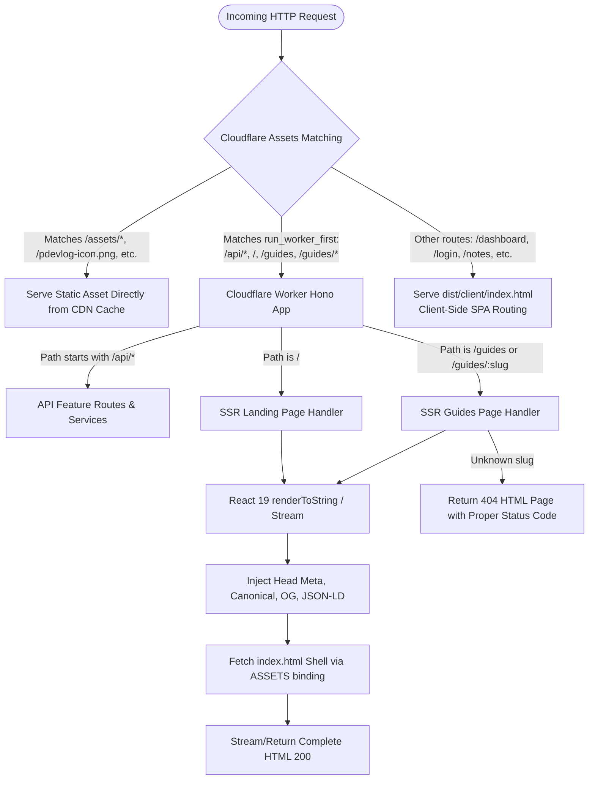

# Implementation Plan: Server-Side Rendering (SSR) for Landing Page & Guides

**Status:** Proposed  
**Target Routes:** `/`, `/guides`, `/guides/:slug`  
**Runtime:** Cloudflare Workers (Edge) + Static Assets  
**Frontend Framework:** React 19 + React Router v7 + Tailwind CSS v4  

---

## 1. Executive Summary & Goals

### 1.1 Context
`pdevlog` is currently built as a single Cloudflare Worker bundling a Hono API and a React 19 Single Page Application (SPA) via `@cloudflare/vite-plugin`. The Cloudflare Assets configuration uses `not_found_handling: "single-page-application"` and `run_worker_first: ["/api/*"]`. As a result, all non-API routes serve a static `index.html` shell, requiring the browser to download and execute ~1.4 MB of JavaScript before the landing page or guides become visible.

### 1.2 Core Objectives
1. **Full Search Engine Optimization (SEO):** Search engine web crawlers (Googlebot, Bingbot, etc.) receive fully formed semantic HTML with complete text, headers, and metadata without relying on JavaScript execution.
2. **Dynamic Social Previews (Open Graph & Twitter Cards):** Each guide route (`/guides/:slug`) and the landing page serve specific `og:title`, `og:description`, `canonical`, and structured data (JSON-LD `Article` / `WebApplication`) for scrapers (Twitter/X, LinkedIn, Discord, Slack, WhatsApp).
3. **Core Web Vitals & Perceived Performance:** Near-instant First Contentful Paint (FCP) and Largest Contentful Paint (LCP) under 100ms by delivering pre-rendered HTML from the nearest Cloudflare Edge data center.
4. **Hybrid SPA/SSR Preservation:** Private authenticated app routes (`/dashboard`, `/workspaces`, `/notes`, `/profile`, `/admin`) remain an isolated, fast SPA. The worker only handles SSR for public marketing and documentation routes.
5. **Zero Hydration Flashes:** Seamless client hydration via React 19 `hydrateRoot`, preventing layout shifts or theme flickering.

---

## 2. High-Level Architecture



---

## 3. Current State vs. Target State Analysis

| Feature | Current State (SPA) | Target State (Hybrid SSR) |
| :--- | :--- | :--- |
| **Edge Routing** | `run_worker_first: ["/api/*"]` | `run_worker_first: ["/api/*", "/", "/guides", "/guides/*"]` |
| **Initial HTML** | Empty `<div id="root"></div>` | Full semantic HTML rendered at Cloudflare Edge |
| **Meta Tags for Guides** | Static generic tags from `index.html` | Dynamic per-guide `<title>`, `<meta description>`, Open Graph, JSON-LD |
| **HTTP Status Codes** | Always 200 OK (even for invalid guide slugs) | 200 OK for valid guides, real 404 Not Found for missing slugs |
| **Client Mounting** | `createRoot(root).render(...)` | Conditional `hydrateRoot(root, ...)` if server HTML exists |
| **Auth CTA in Header/Hero** | Layout shift after async `useQuery(meQueryOptions)` | Server decodes JWT cookie: renders correct CTA immediately |
| **App Routes (`/dashboard`)**| SPA | Unchanged (SPA loaded via Cloudflare Assets fallback) |

---

## 4. Technical Feasibility & Component Audit

### 4.1 Browser API Safety in Target Components
Before rendering on the server (Worker isolate), all client components used by `/` and `/guides` must be audited:

1. **`src/client/components/reveal.tsx` (`Reveal`)**:
   - *Current issue:* Initializes `inView = false` with `opacity-0` until `IntersectionObserver` triggers in `useEffect`. On the server, `useEffect` does not run. Raw SSR HTML would be invisible (`opacity-0`) to search engines and users with disabled/slow JS.
   - *Fix:* In SSR, render visible by default, or wrap animation with progressive enhancement CSS (`.motion-safe:animate-fade-up` only when client-hydrated).
2. **`src/client/features/landing/landing-page.tsx` (`Typewriter`)**:
   - *Current issue:* `Typewriter` starts at character 0.
   - *Fix:* Ensure the full text is present in the server markup (`<span className="sr-only">` already exists; ensure the visible text initializes or gracefully reveals without hydration mismatch).
3. **`src/client/components/theme-provider.tsx` (`ThemeProvider`)**:
   - *Status:* Already has `typeof window === "undefined"` guard and defaults to `"dark"`.
   - *Bonus:* `index.html` already contains an inline blocking `<script>` checking `localStorage.getItem("pdevlog-theme")`, preventing Flash of Unstyled Theme (FOUT).
4. **Markdown Parsing & Guides Data**:
   - Currently, `src/client/features/guides/guides-data.ts` uses `import.meta.glob<string>("/docs/guides/*.md", { query: "?raw", import: "default", eager: true })`.
   - Vite processes `import.meta.glob` during worker bundling as well. We will extract this into a shared content module accessible by both Worker and Client.

---

## 5. Detailed Implementation Steps

### Phase 1: Configuration & Routing Setup

#### 1.1 Update `wrangler.jsonc`
Configure Cloudflare Static Assets to forward the landing page and guide paths to the worker, and expose the `ASSETS` binding so the worker can fetch the client `index.html` template:

```jsonc
{
  "main": "src/worker/index.ts",
  "assets": {
    "binding": "ASSETS",
    "directory": "dist/client",
    "not_found_handling": "single-page-application",
    "run_worker_first": [
      "/api/*",
      "/",
      "/guides",
      "/guides/*"
    ]
  }
}
```

#### 1.2 Update TypeScript Config (`tsconfig.worker.json`)
Enable JSX compilation and include React/DOM types for the worker build:

```jsonc
{
  "compilerOptions": {
    "tsBuildInfoFile": "./node_modules/.tmp/tsconfig.worker.tsbuildinfo",
    "target": "es2023",
    "lib": ["ES2023", "DOM", "DOM.Iterable"],
    "module": "esnext",
    "types": ["./worker-configuration.d.ts", "vite/client"],
    "jsx": "react-jsx",
    "moduleResolution": "bundler",
    "verbatimModuleSyntax": true,
    "noEmit": true
  },
  "include": ["src/worker", "src/shared", "src/client"]
}
```

---

### Phase 2: Shared Content Module (`src/shared/guides/`)

Extract guide loading and parsing into a shared domain module so neither the client nor the server duplicates markdown reading logic.

1. **Move/Refactor:**
   - Create `src/shared/guides/content.ts` (imports `/docs/guides/*.md` using `import.meta.glob`).
   - Parse frontmatter (`title`, `description`, `category`, `order`).
   - Extract headings and calculate reading minutes.
   - Export helper functions: `getAllGuides()`, `getGuideBySlug(slug)`, `getGuideCategories()`.

```ts
// src/shared/guides/types.ts
export type GuideEntry = {
  slug: string;
  title: string;
  description: string;
  category: string;
  order: number;
  content: string;
  headings: { id: string; text: string; level: number }[];
  words: number;
  readingMinutes: number;
};
```

---

### Phase 3: SEO & Meta Tag Generator

Create `src/worker/features/ssr/seo.ts` to generate optimized head tags dynamically:

1. **Dynamic Open Graph & Twitter Cards:**
   - `og:title`, `og:description`, `og:url`, `og:image`.
   - `twitter:card` (`summary_large_image`), `twitter:title`, `twitter:description`.
   - `canonical` link tag matching exact canonical URLs.
2. **Structured Data (JSON-LD):**
   - For `/`: `WebApplication` schema.
   - For `/guides/:slug`: `TechArticle` / `Article` schema with breadcrumb navigation.
3. **HTML Shell Replacer:**
   - Helper function `injectSsrIntoHtml(templateHtml, { headTags, bodyHtml })` that replaces `<title>`, meta placeholders, and `<div id="root"></div>`.

---

### Phase 4: Server-Side Rendering Engine (`src/worker/features/ssr/`)

Create `src/worker/features/ssr/renderer.tsx`:

1. **Template Fetching & In-Memory Caching:**
   ```ts
   let cachedIndexHtml: string | null = null;

   async function getIndexTemplate(assets: Fetcher, reqUrl: string): Promise<string> {
     if (cachedIndexHtml && process.env.NODE_ENV === "production") {
       return cachedIndexHtml;
     }
     const res = await assets.fetch(new Request(new URL("/index.html", reqUrl)));
     const html = await res.text();
     if (process.env.NODE_ENV === "production") {
       cachedIndexHtml = html;
     }
     return html;
   }
   ```
2. **React Rendering:**
   - Use `react-dom/server` (`renderToString` or `renderToReadableStream`).
   - For static content with in-memory markdown data, `renderToString` executes in < 2ms inside the V8 isolate, allowing synchronous HTML string replacement and clean status code control.
3. **Authentication-Aware SSR:**
   - Read `SESSION_COOKIE` from the request.
   - Verify JWT on the edge:
     - If authenticated: Pass user info to pre-render the "Open dashboard" / "Back to Dashboard" buttons.
     - If unauthenticated: Pre-render "Sign in" / "Start Your Personal Dev Log Now" CTA.
   - Zero layout shift upon hydration.

---

### Phase 5: Hono Worker Routes (`src/worker/features/ssr/route.ts`)

Mount public SSR routes in `src/worker/index.ts`:

1. **Route `GET /`**:
   - Renders `<LandingPage />` in a static router context.
   - Injects landing page meta & JSON-LD.
   - Sets cache headers:
     - Guests: `Cache-Control: public, max-age=300, s-maxage=3600, stale-while-revalidate=86400`.
     - Logged in: `Cache-Control: private, no-cache`.
2. **Route `GET /guides`**:
   - 301 Permanent Redirect to `/guides/overview` (or first guide slug), keeping URLs canonical.
3. **Route `GET /guides/:slug`**:
   - Look up slug in `getGuideBySlug(slug)`.
   - If missing:
     - Render custom 404 Guide Not Found view.
     - Return with `status: 404` and `Cache-Control: no-cache`.
   - If present:
     - Render `<GuidesPage />` with `StaticRouterProvider` or pre-populated guide context.
     - Inject guide-specific SEO title, description, and article schema.
     - Set edge cache headers for fast CDN delivery.

---

### Phase 6: Client Hydration & Hardening (`src/client/main.tsx`)

Update client mounting to support seamless hydration:

```tsx
// src/client/main.tsx
import { StrictMode } from "react";
import { createRoot, hydrateRoot } from "react-dom/client";
import { RouterProvider } from "react-router";
import { AppProviders } from "@/client/app/providers";
import { router } from "@/client/app/router";
import "@fontsource-variable/geist";
import "@fontsource-variable/geist-mono";
import "./index.css";

const rootElement = document.getElementById("root")!;

const app = (
  <StrictMode>
    <AppProviders>
      <RouterProvider router={router} />
    </AppProviders>
  </StrictMode>
);

// If server has already rendered DOM nodes into #root, hydrate. Otherwise, createRoot (SPA fallback).
if (rootElement.hasChildNodes()) {
  hydrateRoot(rootElement, app);
} else {
  createRoot(rootElement).render(app);
}
```

#### Component Hardening
- **`Reveal`**: Ensure the container has visible content fallback before JS observer triggers, preventing crawlers from indexing hidden text.
- **`Typewriter`**: Initialize visible text during SSR so search engines capture the hero subtitle without waiting for the animation interval.

---

## 6. Testing & Quality Assurance Plan

### 6.1 Unit & Isolation Tests (`tests/isolation/ssr.test.ts`)
Add automated tests running under `@cloudflare/vitest-pool-workers`:
1. `GET /` returns `200 OK`, `Content-Type: text/html`, contains Hero headline, Open Graph tags, and `WebApplication` JSON-LD.
2. `GET /guides/overview` returns `200 OK`, contains the guide title in `<title>`, rendered Markdown HTML in `#root`, and `TechArticle` JSON-LD.
3. `GET /guides/non-existent-slug` returns `404 Not Found` with helpful fallback HTML.
4. `GET /guides` returns `301 Redirect` to `/guides/overview`.
5. Cookie-authenticated request to `/` or `/guides/*` renders authenticated CTA without error.
6. Verify `/api/*` endpoints and SPA fallback paths remain unaffected.

### 6.2 Manual & Tooling Verification
- **Lighthouse / PageSpeed Insights:** Verify Performance, SEO, and Accessibility scores (target: 95+ on SEO and FCP < 1.0s).
- **Social Card Validators:** Test URLs with Twitter Card Validator, Facebook Sharing Debugger, and OpenGraph.xyz.
- **`curl -s https://...` Inspection:** Verify the raw returned HTML contains all content before client JS execution.

---

## 7. Risk Assessment & Mitigation

| Risk | Impact | Probability | Mitigation Strategy |
| :--- | :--- | :--- | :--- |
| **Hydration Mismatch Warning** | Console warnings / layout flicker | Medium | Ensure identical initial markup: use cookie check for auth, harden `Reveal` and `Typewriter` components. |
| **Worker Bundle Size Growth** | Exceeding Cloudflare Worker bundle limits | Low | Current compressed bundle is ~306 KB (limit is 10 MB on Workers Paid / 1 MB on Free). React SSR adds < 30 KB compressed. |
| **Stale HTML Cache** | Old guide text served after deployment | Low | Cloudflare deployments automatically purge edge cache for the new deployment version. Cache TTL is set with `stale-while-revalidate`. |
| **Regressing SPA routes (`/dashboard`)** | Authenticated routes broken | Very Low | Cloudflare Assets serves static `index.html` for any route not explicitly listed in `run_worker_first`. App layout remains unchanged. |

---

## 8. Rollback Plan

If an issue arises in production:
1. Revert `run_worker_first` in `wrangler.jsonc` to `["/api/*"]`.
2. Push commit to `main`.
3. CI/CD (`deploy.yml`) deploys immediately; Cloudflare Assets instantly resumes 100% SPA serving without database or backend downtime.

